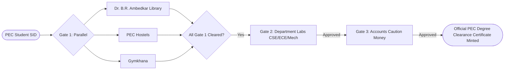

# Punjab Engineering College (PEC Chandigarh)
## Academic Grievance, No-Dues & Clearance Automation Engine
> **A Workflow-Driven Digital Clearance Platform for Punjab Engineering College (Deemed to be University), Sector 12, Chandigarh**  
> *Software Engineering Capstone Project • Office of Dean Academic Affairs (DAA)*

[-brightgreen)](https://github.com/rags-git/clearance-automation-engine/tree/code)
[](https://github.com/rags-git/clearance-automation-engine/tree/code)
[-brightgreen)](https://github.com/rags-git/clearance-automation-engine/tree/code)
[-blueviolet)](./docs/SDLC_PROCESS_MODEL.md)
[](./docs/SOFTWARE_TEST_PLAN.md)
[](https://www.python.org/)
[](https://fastapi.tiangolo.com/)
[](https://react.dev/)
[](https://tailwindcss.com/)

**Submitted by:** Raghav Bhardwaj (SID: `24106017`) & Karan Jain (SID: `24106003`) (B.Tech CSE, Batch 2024-2028)  
**Submitted to:** Dr. Rajesh Bhatia (Course: Software Engineering)  
**Institution:** Punjab Engineering College (Deemed to be University), Sector 12, Chandigarh  

---

## 🌟 Executive Overview & Problem Statement

The **PEC Academic Grievance, No-Dues & Clearance Automation Engine** solves the long-standing bureaucratic problem of manual paper-based clearance circulars at Punjab Engineering College. 

During graduation or internship semesters, a student previously had to physically visit 5+ disparate campus departments—collecting physical ink signatures on paper slips. If any department misplaced records or levied disputed dues (e.g. mess rebate disagreements), the student faced indefinite administrative blocking without transparent recourse.

### How This Platform Solves It:
1. **Automates Multi-Department Sign-off**: Implements the **GoF Behavioral Chain of Responsibility Pattern** to coordinate approvals across Dr. B.R. Ambedkar Central Library, PEC Hostels, Gymkhana, Department Research Labs, and the Accounts Branch.
2. **Cryptographic Validation**: Eliminates forged rubber stamps by stamping an irreversible **HMAC-SHA256 digital signature seal** on every departmental clearance step.
3. **Automated Grievance Redressal (SLA Escalation)**: Enables students to formally dispute liabilities directly from their portal. Tickets operate on strict SLA countdown timers (Critical: 4h, High: 12h, Medium: 24h, Low: 48h) and automatically escalate to the **Dean Academic Affairs (DAA)** upon timer breach.
4. **Verifiable Institutional Degree Clearance Certificates**: Generates tamper-evident, downloadable PDF credentials with official PEC letterhead and a public verification gateway for prospective employers and foreign universities.
5. **Modern Living System UI**: Designed with an ultra-clean developer aesthetic inspired by modern engineering systems, featuring full **Bright & Dark Mode**, responsive telemetry widgets, and an instant **1-Click Role Switcher**.

---

## 🏛️ System Architecture & Design Pattern

### Chain of Responsibility (CoR) Design Pattern
The core verification workflow is governed strictly by the **Behavioral Chain of Responsibility Pattern** (`backend/app/patterns/chain_of_responsibility.py`):

* **Gate 1 (Parallel Gates — Concurrent Verification)**:
  * **Dr. B.R. Ambedkar Central Library**: Book return check & overdue book fines.
  * **PEC Hostels** (Shivalik, Kurukshetra, Himalaya, Aravali, KCH): Key surrender & mess dues.
  * **Gymkhana & Sports Complex**: Equipment check & athletic facility liabilities.
  * *These three departments operate concurrently without blocking one another.*

* **Gate 2 (Sequential Dependency — Department Research Labs)**:
  * Verifies departmental research hardware, workstations, and component returns (CSE / ECE / Mech).
  * **Enforces Strict Barrier**: The lab gate is cryptographically **LOCKED** until **ALL three Gate 1 departments are officially APPROVED**.

* **Gate 3 (Final Gate — Accounts & Caution Money Branch)**:
  * Performs final institutional fee audit, security deposit reconciliation, and releases caution money refund.
  * **Enforces Terminal Barrier**: Locked until **Gate 1 and Gate 2 are 100% APPROVED**.
  * **Certificate Minting**: Upon Gate 3 approval, the platform automatically mints an official institutional Certificate ID and generates a cryptographic SHA-256 digest.



---

## 👥 Demo Personas & Test Credentials (1-Click Switcher Available in UI)

To simplify testing and demonstrations, the system includes pre-seeded demo accounts. In the top navigation bar, click the **`personas`** dropdown to instantly switch between accounts without entering passwords.

All demo accounts use password: `password123`

| Role | Persona Name | Email | SID / Designation | Scenario & State |
| :--- | :--- | :--- | :--- | :--- |
| **Student (Cleared)** | **Raghav Bhardwaj** | `raghav@pec.edu.in` | **`24106017`** (B.Tech CSE) | All 5 gates approved with HMAC signatures. Official PEC certificate ready to view and download. |
| **Student (In-Progress)** | **Karan Jain** | `karan@pec.edu.in` | **`24106003`** (B.Tech CSE) | Gate 1 partially cleared (Library & Hostel approved; Gymkhana ₹500 dues pending). Gates 2 & 3 locked. |
| **Staff (Library)** | Central Librarian | `library@pec.edu.in` | Head, Dr. B.R. Ambedkar Library | Inspect Gate 1 pending book records and sign clearances. |
| **Staff (Hostels)** | Chief Warden | `hostel@pec.edu.in` | PEC Hostels Office | Inspect hostel room surrender and mess fees. |
| **Staff (Sports)** | Sports In-Charge | `sports@pec.edu.in` | President Gymkhana | Inspect equipment liabilities (e.g. Karan's ₹500 dues). |
| **Staff (Labs)** | Head of Department | `labs@pec.edu.in` | HOD - Computing & Research Labs | Inspect Gate 2 lab equipment once Gate 1 clears. |
| **Staff (Accounts)**| Accounts Officer | `accounts@pec.edu.in`| Caution Money & Finance | Gate 3 final release and caution money settlement. |
| **Administrator** | Dean Academic Affairs | `admin@pec.edu.in` | DAA Office (PEC Chandigarh) | High-level telemetry, bottleneck analytics, SLA breach audits, and audit logs. |

---

## ⚡ Quick Start Guide (How to Run Locally)

### 1. Start the Backend API Server
```bash
# In your terminal:
source venv/bin/activate
uvicorn backend.app.main:app --reload --port 8000
```
* **Interactive API Documentation (Swagger UI)**: [http://localhost:8000/docs](http://localhost:8000/docs)
* **Backend Health Check**: [http://localhost:8000/api/v1/health](http://localhost:8000/api/v1/health)

### 2. Start the Frontend Web UI
```bash
# In a second terminal:
cd frontend
npm run dev
```
* **Frontend Web Application**: [http://localhost:5173](http://localhost:5173)

---

## 🧪 Verification & Code Quality (Coursework Standards)

### 1. Pytest Automated Test Suite (73/73 Passed — 100% Success Rate)
The test suite implements the **IEEE Std 829-2008 Software Test Plan**:
* **Black-Box Testing**: Boundary Value Analysis (BVA) on rupee dues amounts & Equivalence Partitioning (EP) on 8-digit PEC SIDs.
* **White-Box Testing**: Chain of Responsibility state machine transitions, dependency unlocking, and sequential barrier checks.
* **Security & RBAC Testing**: Verifies students cannot sign approvals, staff cannot sign cross-department, and tamper detection flags modified signatures.

```bash
./venv/bin/pytest -v --cov=backend/app --cov-report=term-missing
```

### 2. Static Code Analysis (0 PEP 8 Violations)
Validated using flake8 across all backend source modules:
```bash
./venv/bin/flake8 backend/app backend/tests
```

---

## 📖 Software Engineering Coursework Deliverables (Frozen Baseline v3.0.0)

All deliverables are permanently cataloged in the [`docs/`](./docs) directory and compiled into high-resolution vector PDFs:

| Deliverable | Academic Standard | Description | PDF Document | Markdown Source |
| :--- | :---: | :--- | :---: | :---: |
| **1. Software Requirements Specification (SRS)** | **IEEE Std 830-1998** | Comprehensive SRS covering functional/non-functional requirements, PEC 8-digit SIDs, INR currency, and SLA escalation. | [📥 `SRS.pdf`](./docs/SRS.pdf) | [`SRS.md`](./docs/SRS.md) |
| **2. Data Flow Diagrams (DFD) & Data Dictionary** | **Yourdon / DeMarco SSAD** | Context Level 0, Level 1 Decomposition, Level 2 Functional DFDs, and Data Dictionary (`DS-1` to `DS-6`). | [📥 `DFD.pdf`](./docs/DFD.pdf) | [`DFD.md`](./docs/DFD.md) |
| **3. Unified Modeling Language (UML) Models** | **OMG UML 2.5 Specification** | Use Case with `<<include>>`/`<<extend>>`, Class Diagram, Activity Diagram, Sequence Diagrams (1–3), and State Machine. | [📥 `UML_DIAGRAMS.pdf`](./docs/UML_DIAGRAMS.pdf) | [`UML_DIAGRAMS.md`](./docs/UML_DIAGRAMS.md) |
| **4. Chain of Responsibility (CoR) Design Pattern** | **GoF Behavioral Pattern** | Design pattern specification detailing parallel Gate 1, sequential dependency barriers, and HMAC-SHA256 signature generation. | [📥 `DESIGN_PATTERNS.pdf`](./docs/DESIGN_PATTERNS.pdf) | [`DESIGN_PATTERNS.md`](./docs/DESIGN_PATTERNS.md) |
| **5. Static Code Quality & Refactoring Analysis** | **PEP 8 / Flake8 / SonarQube** | Code health audit confirming 0 PEP 8 violations, cyclomatic complexity control, and maintainability index. | [📥 `STATIC_CODE_QUALITY.pdf`](./docs/STATIC_CODE_QUALITY.pdf) | [`STATIC_CODE_QUALITY.md`](./docs/STATIC_CODE_QUALITY.md) |
| **6. SDLC & Process Model Specification** | **ISO/IEC/IEEE 12207 (V-Model)** | Justification of the V-Model (V&V) for frozen baselines, MCDA candidate scoring matrix, and bidirectional Traceability Matrix (RTM). | [📥 `SDLC_PROCESS_MODEL.pdf`](./docs/SDLC_PROCESS_MODEL.pdf) | [`SDLC_PROCESS_MODEL.md`](./docs/SDLC_PROCESS_MODEL.md) |
| **7. Software Test Plan (STP) & Verification Specification** | **IEEE Std 829-2008 & ISO 29119** | Test plan specifying levels of testing, black-box BVA/EP partitions, statement/branch coverage, and the 73-test catalog. | [📥 `SOFTWARE_TEST_PLAN.pdf`](./docs/SOFTWARE_TEST_PLAN.pdf) | [`SOFTWARE_TEST_PLAN.md`](./docs/SOFTWARE_TEST_PLAN.md) |

---

## 🌿 Repository Branch Structure
This repository maintains two dedicated branches on GitHub:
- **`code` Branch (Default):** Complete full-stack codebase with FastAPI backend, React 19 frontend, automated tests, and documentation.
- **[`docs` Branch](https://github.com/rags-git/pec-clearance-automation-engine/tree/docs):** Dedicated documentation branch containing strictly the frozen academic deliverables and vector PDF publications.
