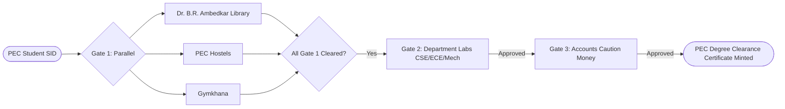

# Punjab Engineering College (PEC Chandigarh)
## Academic Grievance, No-Dues & Clearance Automation Engine
> **A Workflow-Driven Digital Clearance Platform for Punjab Engineering College (Deemed to be University), Sector 12, Chandigarh**  
> *Software Engineering Capstone Project • Office of Dean Academic Affairs (DAA)*

---

## 🌟 Executive Overview
The **PEC Academic Grievance, No-Dues & Clearance Automation Engine** digitizes, automates, and cryptographically validates end-of-semester and graduation clearance workflows across all key facilities of **Punjab Engineering College, Sector 12, Chandigarh**:
- **Dr. B. R. Ambedkar Central Library** (Gate 1 - Parallel)
- **PEC Hostels** (Shivalik, Kurukshetra, Himalaya, Aravali, KCH) (Gate 1 - Parallel)
- **Gymkhana & Sports Complex** (Gate 1 - Parallel)
- **Departmental Research Labs** (CSE, ECE, Mechanical, Electrical, Aerospace, Civil, Metallurgy, Production) (Gate 2 - Sequential Dependency)
- **Accounts & Finance Branch** (Caution Money Reconciliation & Security Refund Release) (Gate 3 - Final Gate & Certificate Issuance)

By replacing physical paper circulars with **digital verification gates**, **HMAC-SHA256 digital signature seals**, and **automated SLA-based grievance escalation to the Dean Academic Affairs (DAA)**, this platform eliminates administrative friction, provides real-time status visibility to students, and generates tamper-evident, verifiable clearance certificates.

---

## 🏛️ System Architecture & Design Pattern

### Chain of Responsibility (CoR) Design Pattern
The core approval workflow is implemented strictly using the **Behavioral Chain of Responsibility Pattern** (`backend/app/patterns/chain_of_responsibility.py`):
- **Gate 1 (Parallel Gates):** Dr. B.R. Ambedkar Central Library, PEC Hostels, and Gymkhana review requests concurrently without blocking one another.
- **Gate 2 (Sequential Dependency):** Department Labs verify hardware/workstations only after **all Gate 1 departments are officially APPROVED**.
- **Gate 3 (Final Gate):** Accounts Branch performs the final fee reconciliation and caution money refund only after **Gate 1 and Gate 2 are fully APPROVED**.
- **Cryptographic Sign-off:** Each approval generates an irreversible HMAC-SHA256 digital signature seal:
  $$\text{Signature} = \text{HMAC-SHA256}(K, \text{staff\_id} \parallel \text{dept\_code} \parallel \text{request\_id} \parallel \text{timestamp})$$



---

## 🚀 Key Features

| Feature | Description |
| :--- | :--- |
| **PEC Role-Based Access Control** | Dedicated portals for **Students** (indexed by 8-digit PEC SID, e.g. `22103042`), **Department Staff**, and **Dean Academic Affairs (DAA)**. |
| **Parallel & Sequential Gates** | Concurrency at Gate 1 with automated dependency unlocking at Gates 2 & 3. |
| **Tamper-Evident Signatures** | Cryptographic HMAC digital signature seals per department approval. |
| **Grievance SLA Engine** | Student appeals (e.g. disputed hostel mess dues) with priority-based SLA deadlines (Critical: 4h, High: 12h, Medium: 24h, Low: 48h) and auto-escalation to the DAA upon breach. |
| **Verifiable PEC PDF Certificates** | Downloadable institutional certificate generated via ReportLab bearing official PEC Chandigarh letterhead, DAA, and DSA signatures. |
| **Public Verification Portal** | Allows employers, verification agencies, or foreign universities to validate certificate authenticity via SHA-256 hash or Certificate ID. |
| **Bottleneck Analytics** | Identifies departmental clearance delays, average resolution hours, and pending backlogs across PEC facilities. |
| **Immutable Audit Trail** | Tamper-evident system log tracking every approval, rejection, and escalation event. |

---

## 👥 Demo Personas (One-Click Switcher Available in UI)

All demo accounts use password: `password123`

| Role | Persona Name | Email | Scenario & Purpose |
| :--- | :--- | :--- | :--- |
| **Student (Cleared)** | Alice Sharma | `alice@pec.edu.in` | B.Tech CSE (SID: `22103042`). All 5 gates approved. PEC certificate ready. |
| **Student (In-Progress)**| Bobdeep Singh | `bob@pec.edu.in` | B.Tech ECE (SID: `22104018`). Library & Kurukshetra Hostel approved; Gymkhana ₹500 pending. |
| **Student (Rejected)** | Charlie Verma | `charlie@pec.edu.in` | B.Tech Mech (SID: `22105029`). Shivalik mess fee (₹3,500) disputed; SLA escalated to DAA. |
| **Student (Demo Apply)**| Alex Grover | `student@pec.edu.in` | B.Tech CSE (SID: `22103001`). Clean student account ready to apply for a new clearance. |
| **Staff (Library)** | Librarian / Head, Central Library | `library@pec.edu.in` | Dr. B.R. Ambedkar Central Library (Gate 1). |
| **Staff (Hostels)** | Chief Warden (Hostels) | `hostel@pec.edu.in` | Shivalik, Kurukshetra, Himalaya, Aravali, KCH Hostels (Gate 1). |
| **Staff (Sports)** | President Gymkhana / Sports In-Charge | `sports@pec.edu.in` | PEC Gymkhana & Swimming Pool Complex (Gate 1). |
| **Staff (Labs)** | Head of Department (HOD) - Computing & Labs | `labs@pec.edu.in` | Departmental Research & Computing Labs (Gate 2 Dependency). |
| **Staff (Accounts)** | Accounts Officer (Caution Money Branch) | `accounts@pec.edu.in`| Caution Money Security Deposit Refund Release (Gate 3). |
| **Administrator** | Dean Academic Affairs (DAA) | `admin@pec.edu.in` | Academic Affairs & Institutional Roster Oversight (PEC Chandigarh). |

---

## ⚡ Quick Start Guide

### 1. Backend Setup & Run

```bash
# 1. Activate Python virtual environment
source venv/bin/activate

# 2. Run database seed (initializes PEC departments, officials, students & requests)
python3 -m backend.app.seed

# 3. Start FastAPI server
uvicorn backend.app.main:app --reload --port 8000
```
- Backend API Docs (Swagger): [http://localhost:8000/docs](http://localhost:8000/docs)
- API Health Check: [http://localhost:8000/api/v1/health](http://localhost:8000/api/v1/health)

### 2. Frontend Setup & Run

```bash
# In a separate terminal:
cd frontend
npm run dev
```
- Frontend Web App: [http://localhost:5173](http://localhost:5173)

---

## 🧪 Testing & Code Quality Verification

### Run Pytest Suite (10 Automated Tests)
```bash
./venv/bin/pytest -v
```

### Run Flake8 Static Analysis (0 Violations)
```bash
./venv/bin/flake8 backend/app
```

---

## 📖 Software Engineering Coursework Deliverables (Frozen Baseline)
> The core specifications below represent the **Frozen Architectural Baseline**. All system boundaries, data contracts, state lifecycles, and sequence models are permanently frozen to ensure full separation from any future implementation tweaks.

- [IEEE 830 Software Requirements Specification (SRS)](file:///Users/raghavbhardwaj/Documents/antigravity/wise-euclid/docs/SRS.md) — *Baseline Version 3.0.0 (Frozen)*
- [Data Flow Diagrams (DFD Level 0, 1, 2) & Data Dictionary](file:///Users/raghavbhardwaj/Documents/antigravity/wise-euclid/docs/DFD.md) — *Baseline Version 3.0.0 (Frozen)*
- [UML Activity, Sequence, Class, Use Case & State Diagrams](file:///Users/raghavbhardwaj/Documents/antigravity/wise-euclid/docs/UML_DIAGRAMS.md) — *Baseline Version 3.0.0 (Frozen)*
- [Chain of Responsibility Design Pattern Documentation](file:///Users/raghavbhardwaj/Documents/antigravity/wise-euclid/docs/DESIGN_PATTERNS.md)
- [Static Code Quality & Refactoring Report](file:///Users/raghavbhardwaj/Documents/antigravity/wise-euclid/docs/STATIC_CODE_QUALITY.md)
