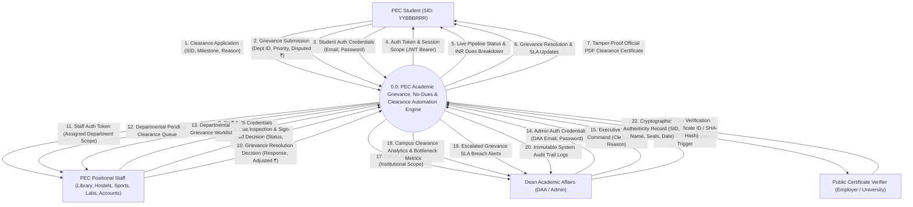
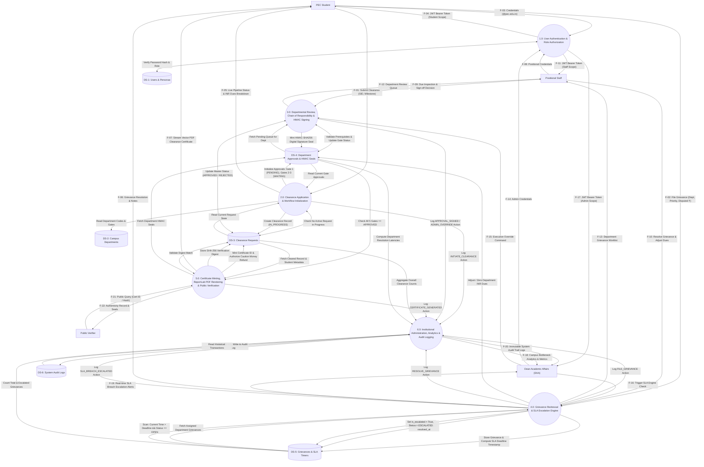
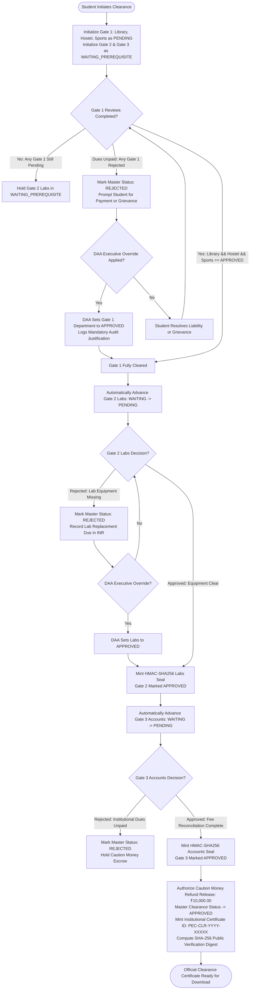
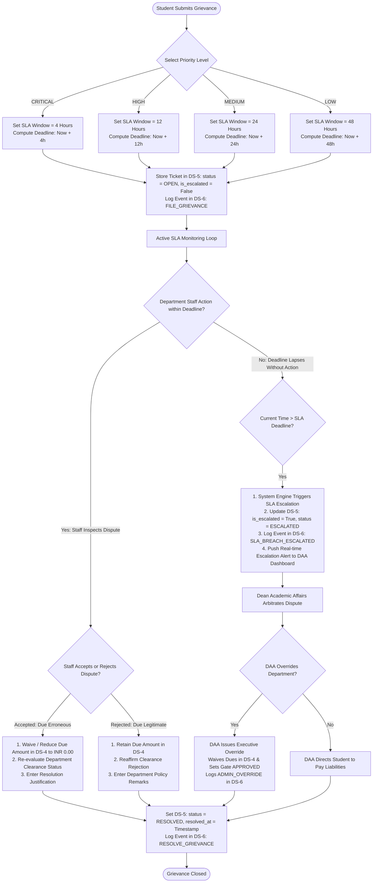
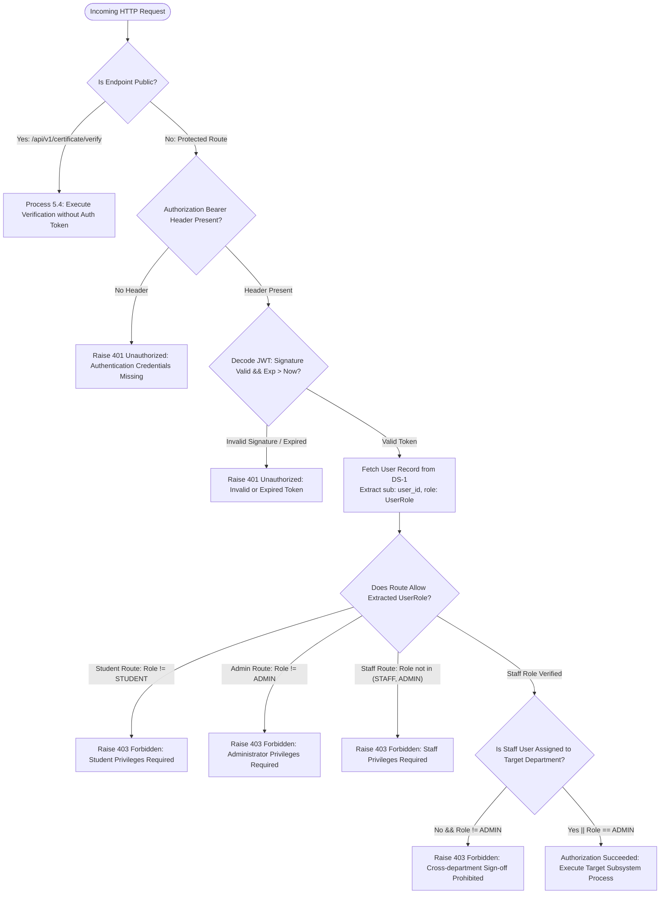

# Data Flow Diagrams (DFD) & Data Dictionary
## Academic Grievance, No-Dues & Clearance Automation Engine

**Standard:** Structured Systems Analysis & Design (SSAD) — **Yourdon & DeMarco / Gane & Sarson Notation**  
**Course:** Software Engineering  
**Institution:** Punjab Engineering College (Deemed to be University), Sector 12, Chandigarh  
**Submitted to:** Dr. Rajesh Bhatia  
**Submitted by:** Raghav Bhardwaj & Karan Jain (B.Tech CSE, Batch 2022–2026)  
**Deliverable Status:** Frozen Final Architectural Baseline (Level 0 & Level 1 Specification)

---

## Table of Contents

1. [Structured Systems Analysis (SSAD) Notational Guide & Formal Rules](#1-structured-systems-analysis-ssad-notational-guide--formal-rules)
   - 1.1 Notational Conventions & Symbol Guide
   - 1.2 Formal DFD Construction Rules & Quality Compliance
2. [DFD Level 0: Context Analysis Diagram](#2-dfd-level-0-context-analysis-diagram)
   - 2.1 Environmental Boundary & Entity Characterization
   - 2.2 Level 0 Context Diagram (Mermaid Model)
   - 2.3 Context-Level Input and Output Boundary Data Flows
3. [DFD Level 1: System Decomposition Diagram](#3-dfd-level-1-system-decomposition-diagram)
   - 3.1 Functional Decomposition Strategy (Processes 1.0 through 6.0)
   - 3.2 Persistent Data Stores Overview (`DS-1` through `DS-6`)
   - 3.3 Level 1 System Decomposition Diagram (Mermaid Model)
   - 3.4 Level 1 Inter-Process, Store, and Entity Data Flows
4. [Process Specifications (P-Specs), Decision Tables & Decision Trees](#4-process-specifications-p-specs-decision-tables--decision-trees)
   - 4.1 Process 3.0: Chain of Responsibility (CoR) Gating & Multi-Signatory Barrier Logic
     - Decision Table 1: Multi-Gate Clearance Pipeline & Prerequisite Barrier Matrix
     - Decision Tree 1: Clearance Gating & Barrier Enforcement Tree (Mermaid)
     - Decision Tree 2: Departmental Liability Assessment & HMAC Signing Flow (Mermaid)
   - 4.2 Process 4.0: Grievance Redressal & SLA Escalation Engine
     - Decision Table 2: Priority SLA Deadline & Automated Escalation Matrix
     - Decision Tree 3: Grievance Arbitration & SLA Breach Escalation Tree (Mermaid)
   - 4.3 Process 1.0 & 3.0: Role-Based Access Control (RBAC) & Authority Validation
     - Decision Table 3: Comprehensive RBAC Authorization Matrix
     - Decision Tree 4: User Authentication & Authorization Gate Tree (Mermaid)
5. [Comprehensive Data Dictionary](#5-comprehensive-data-dictionary)
   - 5.1 Data Stores at Rest (`DS-1` to `DS-6` Schemas)
   - 5.2 Data Elements in Motion (Composite Packets & Primitive Elements)
6. [Formal Horizontal & Vertical Balancing Verification](#6-formal-horizontal--vertical-balancing-verification)

---

## 1. Structured Systems Analysis (SSAD) Notational Guide & Formal Rules

### 1.1 Notational Conventions & Symbol Guide

This specification strictly follows the standardized graphical symbols of **Gane & Sarson** and **Yourdon & DeMarco**:

| Symbol Element | Gane & Sarson / Yourdon Symbol | Mermaid Semantic Representation | Architectural Definition |
| :--- | :---: | :---: | :--- |
| **External Entity** | Double Square / Rectangle | `Entity["External Entity Name"]` | An autonomous origin or destination of data residing outside system boundaries (e.g., Student, Staff). |
| **Process** | Rounded Box / Circle | `Process(("ID: Process Name"))` | An algorithmic transformation converting incoming data packets into outgoing information flows. |
| **Data Store** | Open-Ended Rectangle | `Store[("DS-ID: Data Store Name")]` | A persistent repository holding system data at rest (e.g., relational database tables). |
| **Data Flow** | Directed Vector Arrow | `A -- "Data Flow Name" --> B` | A deterministic pipeline conveying structured data packets between entities, processes, and stores. |

---

### 1.2 Formal DFD Construction Rules & Quality Compliance

To ensure mathematical consistency, the diagrams conform to the classical **Six Golden Rules of Structured Analysis**:

```
+---------------------------------------------------------------------------------------------------+
|                            SIX GOLDEN RULES OF STRUCTURED DFD DESIGN                              |
+------------------------------------+--------------------------------------------------------------+
| Rule 1: Conservation of Data       | No "Miracles" (output without input) or "Black Holes"        |
|                                    | (input without output). Every process transforms data.       |
+------------------------------------+--------------------------------------------------------------+
| Rule 2: Entity-to-Entity Prohibited| External entities cannot communicate directly inside the DFD |
|                                    | boundary; all interaction is mediated by a process.          |
+------------------------------------+--------------------------------------------------------------+
| Rule 3: Store-to-Store Prohibited  | Data stores cannot transfer data directly between themselves |
|                                    | without an executing process reading and writing.            |
+------------------------------------+--------------------------------------------------------------+
| Rule 4: Entity-to-Store Prohibited | External entities cannot directly read or write to internal  |
|                                    | tables without an intervening processing step.               |
+------------------------------------+--------------------------------------------------------------+
| Rule 5: Horizontal & Vertical Parity| Data flows entering/leaving Level 0 Context must balance    |
|                                    | perfectly with the aggregate boundary flows at Level 1.      |
+------------------------------------+--------------------------------------------------------------+
| Rule 6: Decimal Numbering Hierarchy| Unique decimal indexing: Context is 0.0, Level 1 processes   |
|                                    | are 1.0, 2.0, 3.0, 4.0, 5.0, 6.0; Data stores are DS-1..DS-6.|
+------------------------------------+--------------------------------------------------------------+
```

---

## 2. DFD Level 0: Context Analysis Diagram

### 2.1 Environmental Boundary & Entity Characterization

The Context Diagram defines the outermost functional boundary of the **PEC Academic Grievance, No-Dues & Clearance Automation Engine** within **Punjab Engineering College (Sector 12, Chandigarh)**. The central engine (`0.0`) mediates all transactions between four primary external entities:

1. **PEC Student (`Student`):**
   - Identified by an immutable 8-digit PEC SID (`YYBBBRRR`, e.g., `22103042`).
   - Initiates clearance applications, monitors real-time gate progress, views itemized dues in Indian Rupees (`₹`), files grievance appeals, and downloads official tamper-evident PDF certificates.
2. **Positional Department Staff (`Staff`):**
   - Permanent administrative designations: *Librarian* (Dr. B.R. Ambedkar Central Library), *Chief Warden* (PEC Hostels), *President Gymkhana* (Sports Complex), *HOD Labs* (Department Computing & Research Labs), and *Accounts Officer* (Caution Money & Finance Branch).
   - Inspects asset return records, records financial liabilities in INR (`₹`), grants cryptographic sign-offs, and resolves student grievances.
3. **Dean Academic Affairs (`Admin` / DAA):**
   - Chief institutional academic authority overseeing campus-wide clearance compliance.
   - Monitors clearance queues, departmental bottlenecks, and SLA breach escalations; applies executive overrides with mandatory audit justification.
4. **Public Certificate Verifier (`Verifier`):**
   - External employers, background verification agencies, and foreign universities.
   - Validates clearance certificates tokenlessly using Certificate ID or SHA-256 hash digests.

---

### 2.2 Level 0 Context Diagram (Mermaid Model)



---

### 2.3 Context-Level Input and Output Boundary Data Flows

| Flow Index | Flow Name | Direction | Source | Destination | Data Composition / Packet Description |
| :---: | :--- | :---: | :--- | :--- | :--- |
| **F-01** | `Clearance Application` | Input | `Student` | Process `0.0` | `student_sid` + `academic_year` + `semester` + `reason` |
| **F-02** | `Grievance Submission` | Input | `Student` | Process `0.0` | `student_id` + `department_id` + `subject` + `description` + `priority` |
| **F-03** | `Student Auth Credentials` | Input | `Student` | Process `0.0` | `email` (`@pec.edu.in`) + `password` |
| **F-04** | `Auth Token & Session Scope` | Output | Process `0.0` | `Student` | `access_token` (JWT) + `user_id` + `role: STUDENT` + `roll_number` |
| **F-05** | `Live Pipeline Status` | Output | Process `0.0` | `Student` | `overall_status` + 5 $\times$ (`dept_name`, `gate`, `status`, `₹ due_amount`, `remarks`) |
| **F-06** | `Grievance Resolution Updates` | Output | Process `0.0` | `Student` | `grievance_id` + `status` + `staff_response` + `resolved_at` |
| **F-07** | `Official PDF Certificate` | Output | Process `0.0` | `Student` | Binary vector PDF (`%PDF-`) + DAA/DSA letterhead + SHA-256 seal |
| **F-08** | `Staff Auth Credentials` | Input | `Staff` | Process `0.0` | Positional email (`library@pec.edu.in`, etc.) + `password` |
| **F-09** | `Due Inspection & Sign-off` | Input | `Staff` | Process `0.0` | `approval_id` + `decision` (`APPROVED`/`REJECTED`) + `remarks` + `₹ due_amount` |
| **F-10** | `Grievance Resolution Decision`| Input | `Staff` | Process `0.0` | `grievance_id` + `staff_response` + `status: RESOLVED` |
| **F-11** | `Staff Auth Token` | Output | Process `0.0` | `Staff` | `access_token` (JWT) + `role: STAFF` + `department_id` |
| **F-12** | `Department Review Queue` | Output | Process `0.0` | `Staff` | List of pending approvals filtered strictly by staff's `department_id` |
| **F-13** | `Department Grievance Worklist`| Output | Process `0.0` | `Staff` | List of grievances filtered by `department_id` with active SLA countdowns |
| **F-14** | `Admin Auth Credentials` | Input | `Admin` | Process `0.0` | `admin@pec.edu.in` + `password` |
| **F-15** | `Executive Override Command` | Input | `Admin` | Process `0.0` | `clearance_id` + `department_code` + `reason` (`ADMIN_OVERRIDE`) |
| **F-16** | `SLA Evaluation Trigger` | Input | `Admin` | Process `0.0` | Trigger signal for real-time background SLA deadline evaluation |
| **F-17** | `Admin Auth Token` | Output | Process `0.0` | `Admin` | `access_token` (JWT) + `role: ADMIN` |
| **F-18** | `Campus Clearance Analytics` | Output | Process `0.0` | `Admin` | Total counts (`approved`, `pending`, `rejected`) + Dept bottleneck hours |
| **F-19** | `Escalated Grievance Alerts` | Output | Process `0.0` | `Admin` | List of breached tickets with `is_escalated = True` for DAA action |
| **F-20** | `System Audit Trail Logs` | Output | Process `0.0` | `Admin` | Immutable append-only log entries (`actor`, `action`, `target`, `timestamp`) |
| **F-21** | `Public Verification Query` | Input | `Verifier`| Process `0.0` | `cert_id` (`PEC-CLR-YYYY-XXXXX`) OR 64-character SHA-256 digest |
| **F-22** | `Authenticity Record` | Output | Process `0.0` | `Verifier`| `valid: Boolean` + `student_name` + `sid` + `session` + 5 $\times$ HMAC Seals |

---

## 3. DFD Level 1: System Decomposition Diagram

### 3.1 Functional Decomposition Strategy (Processes 1.0 through 6.0)

The Level 1 DFD decomposes the top-level process `0.0` into six dedicated, single-responsibility operational subsystems:

- **`1.0: User Authentication & Role Authorization`:** Validates user credentials, generates Bcrypt hashes, issues signed JWT access tokens, and enforces Role-Based Access Control (RBAC).
- **`2.0: Clearance Application & Workflow Initialization`:** Enforces the single-active-request rule, captures student academic milestones, and initializes the 5 departmental approval records across the 3 gates.
- **`3.0: Departmental Review, Chain of Responsibility & HMAC Signing`:** Orchestrates the multi-department clearance pipeline, allows parallel review at Gate 1, enforces prerequisite barriers at Gate 2 and Gate 3, generates HMAC-SHA256 digital seals, and executes DAA overrides.
- **`4.0: Grievance Redressal & SLA Escalation Engine`:** Manages student disputes, tags priority SLA turnaround windows (4h, 12h, 24h, 48h), evaluates deadline breaches, and auto-escalates delinquent tickets to the DAA.
- **`5.0: Certificate Minting, ReportLab PDF Rendering & Public Verification`:** Mints unique certificate identifiers upon Gate 3 completion, releases the ₹10,000.00 Caution Money deposit, computes SHA-256 verification digests, renders vector PDF certificates, and serves tokenless public authenticity verifications.
- **`6.0: Institutional Administration, Analytics & Audit Logging`:** Computes facility bottleneck statistics, provides institutional oversight for the DAA, and immutably persists all lifecycle transactions into an append-only audit trail.

---

### 3.2 Persistent Data Stores Overview (`DS-1` through `DS-6`)

The system state is maintained across six relational data stores:
- **`DS-1: Users & Personas` (`users` table):** User identities, authentication hashes, roles (`STUDENT`, `STAFF`, `ADMIN`), and department linkages.
- **`DS-2: Campus Departments` (`departments` table):** Academic facilities, institutional codes, gate assignments, and staff head designations.
- **`DS-3: Clearance Requests` (`clearance_requests` table):** Master student clearance records, milestone metadata, overall statuses, and certificate digests.
- **`DS-4: Department Approvals & HMAC Seals` (`department_approvals` table):** Departmental review records, itemized INR dues, reviewer remarks, and HMAC-SHA256 digital seals.
- **`DS-5: Grievances & SLA Timers` (`grievances` table):** Disputed dues tickets, priority classes, computed SLA deadlines, and escalation flags.
- **`DS-6: System Audit Logs` (`audit_logs` table):** Append-only audit events tracking actors, actions, timestamps, and JSON-encoded metadata.

---

### 3.3 Level 1 System Decomposition Diagram (Mermaid Model)



---

### 3.4 Level 1 Inter-Process, Store, and Entity Data Flows

| Process ID | Process Name | Consumed Inputs (From Entities & Stores) | Generated Outputs (To Entities & Stores) |
| :---: | :--- | :--- | :--- |
| **`1.0`** | **Authentication & Role Authorization** | `Student Credentials`, `Staff Credentials`, `Admin Credentials`, `DS-1: users` password hashes. | `JWT Access Tokens` (Student, Staff, Admin scopes with claims: `sub`, `role`, `exp`). |
| **`2.0`** | **Clearance Application & Initialization** | `Clearance Application` from Student, `DS-3: clearance_requests` (duplicate check), `DS-2: departments`. | Created record in `DS-3`, 5 initialized approval rows in `DS-4`, audit event to `6.0`, `Pipeline Status` to Student. |
| **`3.0`** | **Review, Chain of Responsibility & HMAC Signing** | `Due Inspection & Sign-off` from Staff, `Executive Override` from Admin, current approval states from `DS-4`. | Updated status & `HMAC Seal` in `DS-4`, unlocked downstream gates in `DS-4`, request status in `DS-3`, audit event to `6.0`. |
| **`4.0`** | **Grievance Redressal & SLA Escalation** | `Grievance Submission` from Student, `Resolution Decision` from Staff, `SLA Trigger` from Admin, deadline scans on `DS-5`. | Ticket recorded in `DS-5`, updated dues in `DS-4`, `SLA Breach Alerts` to Admin, resolution notes to Student, audit event to `6.0`. |
| **`5.0`** | **Certificate Minting & Verification** | Verified approvals from `DS-4`, cleared request from `DS-3`, `Verification Query` from Verifier. | `Cert ID` and `SHA-256 Digest` stored in `DS-3`, `Official PDF` streamed to Student, `Authenticity Record` to Verifier. |
| **`6.0`** | **Admin Analytics & Audit Logging** | Internal audit events from `2.0`, `3.0`, `4.0`, `5.0`; analytical aggregations across `DS-3`, `DS-4`, `DS-5`, `DS-6`. | Append-only records to `DS-6`, `Campus Analytics` & `Bottleneck Metrics` to Admin, `Audit Trail Logs` to Admin. |

---

## 4. Process Specifications (P-Specs), Decision Tables & Decision Trees

### 4.1 Process 3.0: Chain of Responsibility (CoR) Gating & Multi-Signatory Barrier Logic

#### Process Narrative & Algorithmic Specification:
Process `3.0` coordinates the multi-department approval workflow using the behavioral **Chain of Responsibility** pattern (`backend/app/patterns/chain_of_responsibility.py`). It enforces strict barrier rules:
1. **Gate 1 (Parallel Gates):** Dr. B.R. Ambedkar Central Library, PEC Hostels, and Gymkhana evaluate clearances concurrently. Neither blocks the other.
2. **Gate 2 (Sequential Dependency Barrier):** Departmental Laboratories (CSE/ECE/Mech/etc.) verify hardware and lab equipment returns **strictly after all Gate 1 facilities are APPROVED**. Any review attempt before Gate 1 is 100% complete is rejected with `Prerequisite Gate Error`.
3. **Gate 3 (Final Gate Barrier):** Accounts Branch reconciles caution money and fee balances **strictly after Gates 1 and 2 are 100% APPROVED**.
4. **Cryptographic Sealing:** An approved review generates an irreversible HMAC-SHA256 signature seal:
   $$\text{Digital Signature} = \text{HMAC-SHA256}(K_{\text{secret}}, \text{staff\_id} \parallel \text{dept\_code} \parallel \text{request\_id} \parallel \text{timestamp})$$
5. **Caution Money Disbursement:** Approval at Gate 3 unblocks the release authorization of the student's institutional Caution Money deposit (₹10,000.00).

---

#### Decision Table 1: Multi-Gate Clearance Pipeline & Prerequisite Barrier Matrix

| Rule ID | Gate 1 Library Status | Gate 1 Hostel Status | Gate 1 Sports Status | Gate 2 Labs Status | Gate 3 Accounts Status | DAA Override Active? | Department Target of Current Action | Permitted Action / System State Transition |
| :---: | :---: | :---: | :---: | :---: | :---: | :---: | :---: | :--- |
| **R-101** | `PENDING` | `PENDING` | `PENDING` | `WAITING` | `WAITING` | No | Gate 1 (Lib/Host/Sport) | Allow review; update status to `APPROVED` or `REJECTED`; Mint HMAC seal if approved. |
| **R-102** | `APPROVED` | `APPROVED` | `PENDING` | `WAITING` | `WAITING` | No | Gate 2 (Dept Labs) | **BLOCK WITH 400 ERROR:** Prerequisite Gate 1 Sports is still incomplete. |
| **R-103** | `APPROVED` | `APPROVED` | `REJECTED` | `WAITING` | `WAITING` | No | Gate 2 (Dept Labs) | **BLOCK WITH 400 ERROR:** Prerequisite Gate 1 Sports has outstanding liabilities. |
| **R-104** | `APPROVED` | `APPROVED` | `APPROVED` | `WAITING` | `WAITING` | No | System Evaluation | **AUTOMATIC GATE ADVANCEMENT:** Transition Gate 2 (Dept Labs) from `WAITING` $\rightarrow$ `PENDING`. |
| **R-105** | `APPROVED` | `APPROVED` | `APPROVED` | `PENDING` | `WAITING` | No | Gate 2 (Dept Labs) | Allow HOD Labs review; if approved, mint HMAC seal and update status to `APPROVED`. |
| **R-106** | `APPROVED` | `APPROVED` | `APPROVED` | `APPROVED` | `WAITING` | No | System Evaluation | **AUTOMATIC GATE ADVANCEMENT:** Transition Gate 3 (Accounts) from `WAITING` $\rightarrow$ `PENDING`. |
| **R-107** | `APPROVED` | `APPROVED` | `APPROVED` | `APPROVED` | `PENDING` | No | Gate 3 (Accounts) | Allow Accounts review; if approved, authorize ₹10,000 Caution Money refund release. |
| **R-108** | `APPROVED` | `APPROVED` | `APPROVED` | `APPROVED` | `APPROVED` | No | System Evaluation | **MASTER CLEARANCE GRANTED:** Request status $\rightarrow$ `APPROVED`; Mint Certificate ID & SHA-256 Digest. |
| **R-109** | Any | Any | `REJECTED` | Any | Any | **Yes (DAA)** | Gate 1 (Sports) | **EXECUTIVE OVERRIDE:** Set status $\rightarrow$ `APPROVED`; Clear dues; Mint HMAC seal; Log `ADMIN_OVERRIDE` in `DS-6`. |

---

#### Decision Tree 1: Clearance Gating & Barrier Enforcement Tree (Mermaid)



---

#### Decision Tree 2: Departmental Liability Assessment & HMAC Signing Flow (Mermaid)

```mermaid
flowchart TD
    ReviewStart([Department Staff Opens Student Review]) --> CheckPrereq{Are Upstream Gates Satisfied?}
    
    CheckPrereq -- No --> RejectPrereq[Raise 400 Bad Request: Prerequisite Gate Dependency Incomplete]
    CheckPrereq -- Yes --> InspectAssets[Staff Inspects Physical Asset Returns<br/>Library Books / Hostel Room Keys / Sports Equipment / Lab Kits]
    
    InspectAssets --> DuesExist{Outstanding Liabilities Found?}
    
    DuesExist -- Yes: Unreturned Assets or Fines --> EnterDues[1. Enter Dues Amount in INR ₹ > 0.00<br/>2. Enter Itemized Positional Remarks<br/>3. Select Action: REJECTED]
    EnterDues --> SaveReject[Save to DS-4: status = REJECTED, due_amount = ₹X.XX<br/>Set digital_signature = NULL<br/>Update DS-3: overall_status = REJECTED<br/>Log Event in DS-6: DEPT_REJECTED]
    SaveReject --> StopReject([Clearance Blocked Pending Settlement / Grievance])
    
    DuesExist -- No: All Records Clear --> EnterClear[1. Set Dues Amount = ₹0.00<br/>2. Enter Clearance Remarks<br/>3. Select Action: APPROVED]
    EnterClear --> GenHMAC[Compute Cryptographic HMAC-SHA256 Seal:<br/>HMAC(Secret_Key, staff_id + dept_code + request_id + timestamp)]
    GenHMAC --> SaveApprove[Save to DS-4: status = APPROVED, due_amount = 0.00<br/>Attach digital_signature = SIG-v1:DEPT:hash24<br/>Log Event in DS-6: DEPT_APPROVED]
    SaveApprove --> CheckNext[Trigger Process 3.0: Evaluate Downstream Gate Unlocking]
    CheckNext --> StopApprove([Department Clearance Finalized & Sealed])
```

---

### 4.2 Process 4.0: Grievance Redressal & SLA Escalation Engine

#### Process Narrative & Algorithmic Specification:
Process `4.0` governs student appeals regarding disputed fines (e.g., contested hostel mess bills or library replacement costs). It enforces dynamic Service Level Agreements (SLA):
1. **Dynamic Deadline Calculation:**
   $$\text{SLA Deadline Timestamp} = \text{Submission Timestamp} + \text{SLA Window}(\text{Priority})$$
   - $\text{CRITICAL}$ Priority: **4 Hours**
   - $\text{HIGH}$ Priority: **12 Hours**
   - $\text{MEDIUM}$ Priority: **24 Hours**
   - $\text{LOW}$ Priority: **48 Hours**
2. **Real-time Escalation Scanner:** Evaluates all tickets where `Current_Time > sla_deadline` and `status in ('OPEN', 'IN_REVIEW')`. Expired tickets are updated to `status = 'ESCALATED'` with `is_escalated = True`.
3. **Executive Alerts:** Breached tickets generate immediate visual escalation banners on the Dean Academic Affairs dashboard.
4. **Dispute Settlement:** Resolution by staff or DAA updates the ticket to `RESOLVED`, sets `resolved_at`, adjusts or waives the disputed fine in `DS-4`, and logs the settlement in `DS-6`.

---

#### Decision Table 2: Priority SLA Deadline & Automated Escalation Matrix

| Rule ID | Ticket Priority | Elapsed Time ($t_{\text{now}} - t_{\text{submitted}}$) | Current Ticket Status | Department Official Action | System SLA Engine Action | Master Ticket Status Mutation |
| :---: | :---: | :---: | :---: | :---: | :---: | :---: |
| **R-201** | `CRITICAL` | $\le$ 4 Hours | `OPEN` | Pending review | Maintain live countdown timer (4h window). | No change (`OPEN`, `is_escalated = False`) |
| **R-202** | `CRITICAL` | **> 4 Hours** | `OPEN` | None taken | **TRIGGER AUTO-ESCALATION:** Flag ticket for DAA; log breach event. | **`ESCALATED`** (`is_escalated = True`) |
| **R-203** | `HIGH` | $\le$ 12 Hours | `OPEN` | Pending review | Maintain live countdown timer (12h window). | No change (`OPEN`, `is_escalated = False`) |
| **R-204** | `HIGH` | **> 12 Hours** | `OPEN` | None taken | **TRIGGER AUTO-ESCALATION:** Flag ticket for DAA; log breach event. | **`ESCALATED`** (`is_escalated = True`) |
| **R-205** | `MEDIUM` | $\le$ 24 Hours | `OPEN` | Pending review | Maintain live countdown timer (24h window). | No change (`OPEN`, `is_escalated = False`) |
| **R-206** | `MEDIUM` | **> 24 Hours** | `OPEN` | None taken | **TRIGGER AUTO-ESCALATION:** Flag ticket for DAA; log breach event. | **`ESCALATED`** (`is_escalated = True`) |
| **R-207** | `LOW` | $\le$ 48 Hours | `OPEN` | Pending review | Maintain live countdown timer (48h window). | No change (`OPEN`, `is_escalated = False`) |
| **R-208** | `LOW` | **> 48 Hours** | `OPEN` | None taken | **TRIGGER AUTO-ESCALATION:** Flag ticket for DAA; log breach event. | **`ESCALATED`** (`is_escalated = True`) |
| **R-209** | Any | Any | `OPEN` / `ESCALATED` | Staff/DAA registers resolution remarks | Record `staff_response`; zero or adjust INR dues in `DS-4`. | **`RESOLVED`** (`resolved_at = Now`) |

---

#### Decision Tree 3: Grievance Arbitration & SLA Breach Escalation Tree (Mermaid)



---

### 4.3 Process 1.0 & 3.0: Role-Based Access Control (RBAC) & Authority Validation

#### Process Narrative & Algorithmic Specification:
The API Gateway enforces strict **Role-Based Access Control (RBAC)** across four user scopes: `STUDENT`, `STAFF`, `ADMIN` (DAA), and unauthenticated `PUBLIC`. Unauthorized requests are blocked with HTTP `401 Unauthorized` or `403 Forbidden`.

---

#### Decision Table 3: Comprehensive RBAC Authorization Matrix

| Action / Operation | API Route Endpoint | `STUDENT` | `STAFF` (Own Dept) | `STAFF` (Other Dept) | `ADMIN` (DAA) | `PUBLIC` | Enforced Error on Breach |
| :--- | :--- | :---: | :---: | :---: | :---: | :---: | :---: |
| **Apply for Clearance** | `POST /api/v1/clearance/apply` | **ALLOW** | DENY | DENY | DENY | DENY | `403 Forbidden` |
| **View My Pipeline** | `GET /api/v1/clearance/my-requests` | **ALLOW** | DENY | DENY | DENY | DENY | `401 / 403` |
| **View Staff Queue** | `GET /api/v1/clearance/staff/queue` | DENY | **ALLOW** | DENY | **ALLOW** | DENY | `403 Forbidden` |
| **Sign Department Gate**| `POST /api/v1/clearance/staff/decision/{id}` | DENY | **ALLOW** | DENY | **ALLOW** | DENY | `403 Forbidden` |
| **File Grievance Ticket**| `POST /api/v1/grievance` | **ALLOW** | DENY | DENY | DENY | DENY | `403 Forbidden` |
| **Resolve Grievance** | `POST /api/v1/grievance/{id}/resolve` | DENY | **ALLOW** | DENY | **ALLOW** | DENY | `403 Forbidden` |
| **Trigger SLA Scan** | `POST /api/v1/grievance/trigger-sla-check` | DENY | **ALLOW** | **ALLOW** | **ALLOW** | DENY | `403 Forbidden` |
| **View Campus Analytics**| `GET /api/v1/admin/analytics` | DENY | **ALLOW** | **ALLOW** | **ALLOW** | DENY | `403 Forbidden` |
| **View System Audit Logs**| `GET /api/v1/admin/audit-logs` | DENY | DENY | DENY | **ALLOW** | DENY | `403 Forbidden` |
| **Execute Admin Override**| `POST /api/v1/admin/clearance/{id}/override` | DENY | DENY | DENY | **ALLOW** | DENY | `403 Forbidden` |
| **Download PDF Cert** | `GET /api/v1/certificate/download/{id}` | **ALLOW** | **ALLOW** | **ALLOW** | **ALLOW** | DENY | `401 Unauthorized` |
| **Public Verification** | `GET /api/v1/certificate/verify` | **ALLOW** | **ALLOW** | **ALLOW** | **ALLOW** | **ALLOW** | None (Public Endpoint) |

---

#### Decision Tree 4: User Authentication & Authorization Gate Tree (Mermaid)



---

## 5. Comprehensive Data Dictionary

### 5.1 Data Stores at Rest (`DS-1` to `DS-6` Schemas)

The schemas reflect the exact production relational database definitions (`backend/app/models/models.py`):

#### `DS-1`: Users & Personas (`users` table)
| Column Name | SQL Type | Constraint | Description | Concrete Example |
| :--- | :--- | :---: | :--- | :--- |
| `id` | `INTEGER` | Primary Key | Auto-incrementing surrogate identifier | `1` |
| `email` | `VARCHAR(120)` | Unique, Not Null | Institutional PEC email address | `alice@pec.edu.in` |
| `full_name` | `VARCHAR(120)` | Not Null | User full name or administrative title | `Alice Sharma` / `Chief Warden` |
| `role` | `ENUM` | Not Null | Security role: `STUDENT`, `STAFF`, `ADMIN` | `STUDENT` |
| `roll_number` | `VARCHAR(50)` | Unique, Nullable | 8-digit PEC SID format (`YYBBBRRR`) | `22103042` |
| `department_id` | `INTEGER` | Foreign Key (`departments.id`) | Foreign key linking staff to their facility | `1` (Library) |
| `hashed_password`| `VARCHAR(255)`| Not Null | Salted Bcrypt hash (work factor 12) | `$2b$12$e8x...` |
| `created_at` | `DATETIME` | Default UTC | Timestamp of user provisioning | `2026-05-01 09:00:00` |

---

#### `DS-2`: Campus Departments (`departments` table)
| Column Name | SQL Type | Constraint | Description | Concrete Example |
| :--- | :--- | :---: | :--- | :--- |
| `id` | `INTEGER` | Primary Key | Department surrogate identifier | `1` |
| `name` | `VARCHAR(100)` | Not Null | Official campus facility designation | `Dr. B. R. Ambedkar Central Library` |
| `code` | `VARCHAR(50)` | Unique, Not Null | Institutional department code | `LIBRARY`, `HOSTEL`, `SPORTS`, `LABS`, `ACCOUNTS` |
| `clearance_gate` | `INTEGER` | Not Null | Pipeline gate level: `1` (Parallel), `2` (Labs), `3` (Accounts) | `1` |
| `description` | `VARCHAR(255)` | Nullable | Detailed functional remit | `Central university library textbook dues` |
| `staff_head_name`| `VARCHAR(100)` | Nullable | Positional title of head signatory | `Chief Librarian` |

---

#### `DS-3`: Clearance Requests (`clearance_requests` table)
| Column Name | SQL Type | Constraint | Description | Concrete Example |
| :--- | :--- | :---: | :--- | :--- |
| `id` | `INTEGER` | Primary Key | Clearance request unique identifier | `42` |
| `student_id` | `INTEGER` | Foreign Key (`users.id`) | References applicant student | `1` (Alice Sharma) |
| `academic_year` | `VARCHAR(20)` | Not Null | Enrolled academic year session | `2025-2026` |
| `semester` | `VARCHAR(20)` | Not Null | Current academic semester | `Semester 8` |
| `reason` | `VARCHAR(100)` | Not Null | Institutional justification | `Graduation Clearance & Degree Award` |
| `overall_status` | `ENUM` | Not Null | Master status: `PENDING`, `IN_PROGRESS`, `APPROVED`, `REJECTED` | `APPROVED` |
| `certificate_id` | `VARCHAR(64)` | Unique, Nullable | Minted certificate number | `PEC-CLR-2026-00042` |
| `certificate_hash`| `VARCHAR(128)`| Nullable | SHA-256 public verification digest | `7f83b1657ff1fc53b92dc18148a1d65dfc...` |
| `created_at` | `DATETIME` | Default UTC | Timestamp of clearance application | `2026-05-01 10:00:00` |
| `updated_at` | `DATETIME` | On Update UTC | Timestamp of last state mutation | `2026-05-03 14:30:00` |

---

#### `DS-4`: Department Approvals (`department_approvals` table)
| Column Name | SQL Type | Constraint | Description | Concrete Example |
| :--- | :--- | :---: | :--- | :--- |
| `id` | `INTEGER` | Primary Key | Approval record surrogate key | `201` |
| `request_id` | `INTEGER` | Foreign Key (`clearance_requests.id`) | References parent clearance request | `42` |
| `department_id` | `INTEGER` | Foreign Key (`departments.id`) | References reviewing department | `1` (Library) |
| `status` | `ENUM` | Not Null | `WAITING_PREREQUISITE`, `PENDING`, `APPROVED`, `REJECTED` | `APPROVED` |
| `staff_id` | `INTEGER` | Foreign Key (`users.id`) | References signing staff official | `2` (Librarian) |
| `approved_at` | `DATETIME` | Nullable | Exact timestamp of review sign-off | `2026-05-02 11:15:00` |
| `remarks` | `TEXT` | Nullable | Itemized inspection commentary | `All library books accounted for. Zero dues.` |
| `due_amount` | `FLOAT` | Default 0.0 | Outstanding liability in INR (`₹`) | `0.00` |
| `digital_signature`| `VARCHAR(255)`| Nullable | Keyed HMAC-SHA256 signature seal | `SIG-v1:LIBRARY:8a7f9c2d1b4e5f...` |

---

#### `DS-5`: Grievances & SLA Timers (`grievances` table)
| Column Name | SQL Type | Constraint | Description | Concrete Example |
| :--- | :--- | :---: | :--- | :--- |
| `id` | `INTEGER` | Primary Key | Grievance ticket identifier | `8` |
| `student_id` | `INTEGER` | Foreign Key (`users.id`) | References appellant student | `3` (Charlie Verma) |
| `clearance_request_id`| `INTEGER`| Foreign Key (`clearance_requests.id`)| Associated clearance application | `42` |
| `department_id` | `INTEGER` | Foreign Key (`departments.id`) | Target disputed department | `2` (Hostels) |
| `subject` | `VARCHAR(200)`| Not Null | Summary dispute title | `Shivalik Mess Dues Inaccuracy` |
| `description` | `TEXT` | Not Null | Detailed appeal justification | `Internship sanctioned by DAA for Jan-June` |
| `priority` | `ENUM` | Not Null | `LOW`, `MEDIUM`, `HIGH`, `CRITICAL` | `HIGH` |
| `status` | `ENUM` | Not Null | `OPEN`, `IN_REVIEW`, `RESOLVED`, `ESCALATED` | `ESCALATED` |
| `sla_hours` | `INTEGER` | Default 24 | Allowed resolution window in hours | `12` |
| `sla_deadline` | `DATETIME` | Not Null | Computed absolute expiration deadline | `2026-05-02 22:00:00` |
| `is_escalated` | `BOOLEAN` | Default False | True if deadline passed without resolution | `True` |
| `staff_response` | `TEXT` | Nullable | Final written response from authority | `Mess rebate verified; dues waived.` |
| `created_at` | `DATETIME` | Default UTC | Submission timestamp | `2026-05-02 10:00:00` |
| `resolved_at` | `DATETIME` | Nullable | Exact timestamp of resolution | `2026-05-03 08:30:00` |

---

#### `DS-6`: System Audit Logs (`audit_logs` table)
| Column Name | SQL Type | Constraint | Description | Concrete Example |
| :--- | :--- | :---: | :--- | :--- |
| `id` | `INTEGER` | Primary Key | Sequential audit entry index | `1052` |
| `actor_id` | `INTEGER` | Nullable | User ID of the mutating actor | `2` |
| `actor_name` | `VARCHAR(120)`| Not Null | Human-readable name of the actor | `Chief Librarian` / `SLA_ENGINE` |
| `actor_role` | `VARCHAR(50)` | Not Null | Security role: `STUDENT`, `STAFF`, `ADMIN`, `SYSTEM` | `STAFF` |
| `action` | `VARCHAR(100)`| Not Null | Immutable action verb | `LIBRARY_APPROVED`, `ADMIN_OVERRIDE` |
| `target_type` | `VARCHAR(50)` | Not Null | Entity category: `CLEARANCE`, `GRIEVANCE` | `CLEARANCE` |
| `target_id` | `INTEGER` | Nullable | Foreign ID of the affected entity | `42` |
| `details` | `TEXT` | Nullable | Textual metadata and mutation payload | `Decision: APPROVED. Dues: ₹0.00. Sig: SIG-v1...` |
| `timestamp` | `DATETIME` | Default UTC | Microsecond precision timestamp | `2026-05-02 11:15:02` |

---

### 5.2 Data Elements in Motion (Composite Packets & Primitive Elements)

#### Composite Data Packets:
1. **`Clearance_Submission_Packet`:**
   $$\text{Packet} = \{\text{student\_sid: String}, \text{academic\_year: String}, \text{semester: String}, \text{reason: String}\}$$
2. **`Department_Signoff_Packet`:**
   $$\text{Packet} = \{\text{approval\_id: Int}, \text{decision: Enum}, \text{remarks: String}, \text{due\_amount: Float} \ge 0.00\}$$
3. **`Grievance_Filing_Packet`:**
   $$\text{Packet} = \{\text{department\_id: Int}, \text{subject: String}, \text{description: String}, \text{priority: Enum}\}$$
4. **`Public_Verification_Result_Packet`:**
   $$\text{Packet} = \{\text{valid: Bool}, \text{cert\_id: String}, \text{student\_name: String}, \text{sid: String}, \text{signatures: Array[HMAC\_Seal]}\}$$

#### Primitive Data Elements:
- **`SID` (Student Identification Number):**
  - **Type:** String (8 digits).
  - **Regular Expression:** `^[0-9]{8}$` (e.g., `22103042`).
  - **Domain:** Valid Punjab Engineering College student enrollment codes.
- **`due_amount` (Departmental Liability):**
  - **Type:** Float (2 decimal precision).
  - **Currency:** Indian Rupee (`₹` / INR).
  - **Domain:** `[0.00, 500000.00]`. Negative numbers are rejected by schema validators with `422 Unprocessable Entity`.
- **`digital_signature` (HMAC Approval Seal):**
  - **Type:** String (ASCII, formatted).
  - **Syntax:** `SIG-v1:<DEPT_CODE>:<24_CHAR_HEX>` (e.g., `SIG-v1:LIBRARY:a7f9b2c3d4e5f6018293a4b5`).
  - **Security Property:** Non-repudiable; invalidates if staff ID, department, request ID, or timestamp are altered.
- **`certificate_hash` (Public Verification Digest):**
  - **Type:** String (64-character lowercase hexadecimal).
  - **Formula:** `SHA-256(cert_id + ":" + student_id + ":" + academic_year + ":" + semester)`

---

## 6. Formal Horizontal & Vertical Balancing Verification

To ensure that the DFD specifications contain **zero structural discrepancies** and are **frozen permanently**, the table below verifies horizontal and vertical parity between Level 0 and Level 1:

| Level 0 Boundary Flow Index | Boundary Flow Name | External Entity | Level 0 Direction | Level 1 Connecting Subsystem Process | Balancing Parity Status |
| :---: | :--- | :---: | :---: | :---: | :---: |
| **F-01** | `Clearance Application` | `Student` | Input | Process `2.0: Clearance Application & Workflow` | **BALANCED (100%)** |
| **F-02** | `Grievance Submission` | `Student` | Input | Process `4.0: Grievance Redressal & SLA Engine` | **BALANCED (100%)** |
| **F-03** | `Student Auth Credentials` | `Student` | Input | Process `1.0: Authentication & Role Authorization` | **BALANCED (100%)** |
| **F-04** | `Auth Token & Session Scope` | `Student` | Output | Process `1.0: Authentication & Role Authorization` | **BALANCED (100%)** |
| **F-05** | `Live Pipeline Status` | `Student` | Output | Process `2.0: Clearance Application & Workflow` | **BALANCED (100%)** |
| **F-06** | `Grievance Resolution Updates`| `Student` | Output | Process `4.0: Grievance Redressal & SLA Engine` | **BALANCED (100%)** |
| **F-07** | `Official PDF Certificate` | `Student` | Output | Process `5.0: Certificate Minting & Verification` | **BALANCED (100%)** |
| **F-08** | `Staff Auth Credentials` | `Staff` | Input | Process `1.0: Authentication & Role Authorization` | **BALANCED (100%)** |
| **F-09** | `Due Inspection & Sign-off` | `Staff` | Input | Process `3.0: Review, Chain of Responsibility & HMAC`| **BALANCED (100%)** |
| **F-10** | `Grievance Resolution Decision`| `Staff` | Input | Process `4.0: Grievance Redressal & SLA Engine` | **BALANCED (100%)** |
| **F-11** | `Staff Auth Token` | `Staff` | Output | Process `1.0: Authentication & Role Authorization` | **BALANCED (100%)** |
| **F-12** | `Department Review Queue` | `Staff` | Output | Process `3.0: Review, Chain of Responsibility & HMAC`| **BALANCED (100%)** |
| **F-13** | `Department Grievance Worklist`| `Staff` | Output | Process `4.0: Grievance Redressal & SLA Engine` | **BALANCED (100%)** |
| **F-14** | `Admin Auth Credentials` | `Admin` | Input | Process `1.0: Authentication & Role Authorization` | **BALANCED (100%)** |
| **F-15** | `Executive Override Command` | `Admin` | Input | Process `3.0: Review, Chain of Responsibility & HMAC`| **BALANCED (100%)** |
| **F-16** | `SLA Evaluation Trigger` | `Admin` | Input | Process `4.0: Grievance Redressal & SLA Engine` | **BALANCED (100%)** |
| **F-17** | `Admin Auth Token` | `Admin` | Output | Process `1.0: Authentication & Role Authorization` | **BALANCED (100%)** |
| **F-18** | `Campus Clearance Analytics` | `Admin` | Output | Process `6.0: Administration, Analytics & Logging` | **BALANCED (100%)** |
| **F-19** | `Escalated Grievance Alerts` | `Admin` | Output | Process `4.0: Grievance Redressal & SLA Engine` | **BALANCED (100%)** |
| **F-20** | `System Audit Trail Logs` | `Admin` | Output | Process `6.0: Administration, Analytics & Logging` | **BALANCED (100%)** |
| **F-21** | `Public Verification Query` | `Verifier` | Input | Process `5.0: Certificate Minting & Verification` | **BALANCED (100%)** |
| **F-22** | `Authenticity Record & Seals` | `Verifier` | Output | Process `5.0: Certificate Minting & Verification` | **BALANCED (100%)** |

**Conclusion:** All 22 boundary data flows exhibit exact horizontal and vertical parity between Level 0 and Level 1. The data stores (`DS-1` through `DS-6`) match production relational tables, decision tables cover all operational branching conditions, decision trees visually articulate complex state lifecycles, and no lower-level decompositions exceed Level 1. This document constitutes the **Frozen Final Baseline** of the Structured Systems Analysis for the Punjab Engineering College Clearance Automation Engine.
