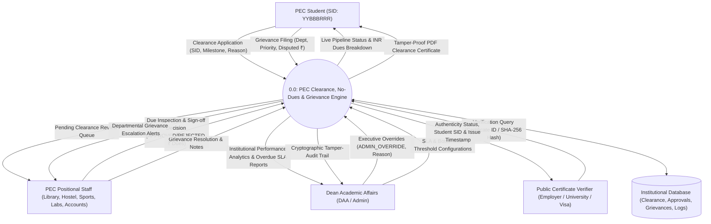
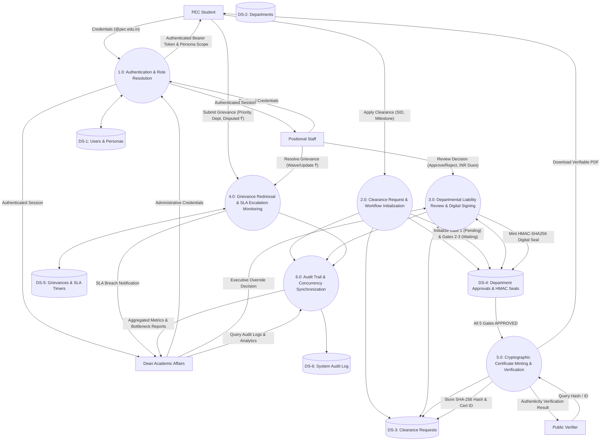
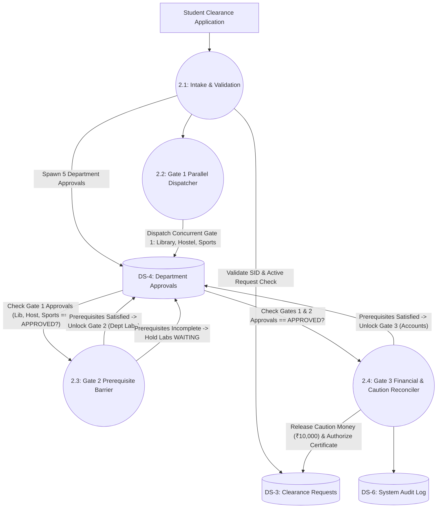
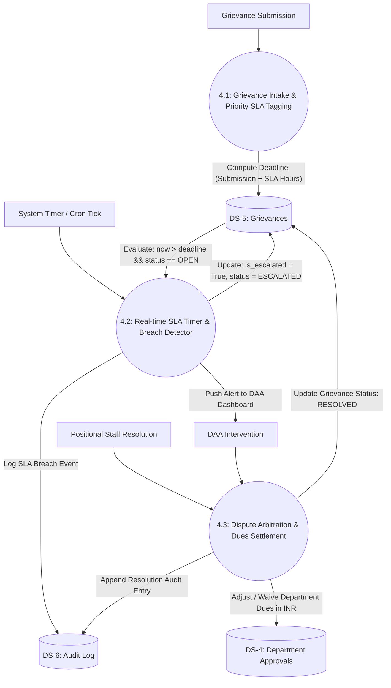
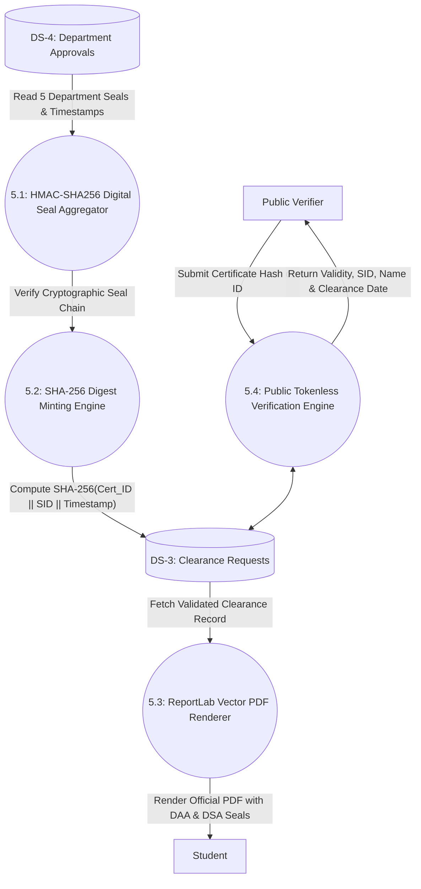

# Data Flow Diagrams (DFD) & Data Dictionary
## Academic Grievance, No-Dues & Clearance Automation Engine
**Punjab Engineering College (Deemed to be University), Sector 12, Chandigarh**  
**Submitted by:** Raghav Bhardwaj & Karan Jain (B.Tech Computer Science & Engineering)  
**Submitted to:** Dr. Rajesh Bhatia (Course: Software Engineering)  

---

## 1. Notational Conventions & Symbol Guide

| Symbol Element | Gane & Sarson / Yourdon Notation | Mermaid Representation | Semantic Meaning |
| :--- | :---: | :---: | :--- |
| **External Entity** | Double Square / Rectangle | `Entity["External Entity"]` | Source or destination of data outside system boundaries (e.g., Student, Staff). |
| **Process** | Rounded Rectangle / Circle | `Process(("ID: Process Name"))` | Transforms incoming data flows into outgoing data flows. |
| **Data Store** | Open Rectangle / Parallel Lines | `Store[("DS-ID: Data Store")]` | Repository of persistent data at rest (e.g., relational tables). |
| **Data Flow** | Directed Vector Arrow | `A -- "Data Flow Name" --> B` | Pipeline carrying packetized data elements between entities, processes, and stores. |

### 1.1 Formal DFD Construction Rules & Quality Compliance
This specification adheres strictly to the classic **Yourdon & DeMarco** and **Gane & Sarson** structured systems analysis rules:

| Structured Analysis Rule | Rule Description & Formal Constraint | Compliance Verification in this DFD |
| :--- | :--- | :--- |
| **Rule 1: Conservation of Data** | A process cannot create data out of nothing ("Miracle") nor consume data without producing output ("Black Hole"). | Every process (`1.0` through `6.0` and `2.1`..`5.4`) transforms identifiable inputs into outputs. |
| **Rule 2: Entity-to-Entity Forbidden** | External entities cannot communicate directly within the DFD boundary without passing through a process. | Verified: All student, staff, and admin interactions pass through numbered processes. |
| **Rule 3: Store-to-Store Forbidden** | Data cannot move directly from one data store to another without process manipulation. | Verified: Table updates (e.g. `DS-4` to `DS-3`) are mediated by processes `3.0`, `5.1`, and `5.2`. |
| **Rule 4: Entity-to-Store Forbidden** | External entities cannot directly read or write to data stores without an intervening process. | Verified: All persistence calls are strictly routed through processes `1.0`, `2.0`, `3.0`, `4.0`. |
| **Rule 5: Balancing Rule (Horizontal & Vertical)** | Inputs and outputs of a parent process at Level $N$ must exactly match the aggregate boundary flows at Level $N+1$. | Verified: Level 0 external flows balance with Level 1, and Level 1 processes balance with Level 2. |
| **Rule 6: Unique Hierarchical Numbering** | Every process is uniquely identified using hierarchical decimal notation (`0.0` $\rightarrow$ `1.0`..`6.0` $\rightarrow$ `2.1`..`2.4`). | Verified: Clear hierarchical numbering applied across all levels. |

---

## 2. DFD Level 0: Context Analysis Diagram

The Level 0 Context Diagram establishes the highest-level operational boundary of the Clearance Engine within the Punjab Engineering College ecosystem. It identifies the four primary external entities interacting with the central clearance processing environment:

---

## 3. DFD Level 1: System Decomposition Diagram

The Level 1 DFD decomposes the top-level process `0.0` into six modular, cohesive functional processes governing authentication, clearance workflow, liability assessment, grievance arbitration, cryptographic certification, and audit synchronization:

---

## 4. DFD Level 2: Sub-Process Decompositions

### 4.1 Process 2.0 Decomposition: Clearance Gating & Chain of Responsibility
This diagram isolates how departmental clearance requests flow across the three sequential and parallel validation gates:

### 4.2 Process 4.0 Decomposition: Grievance Redressal & SLA Escalation Engine
This diagram details the priority-based SLA calculation, automatic timer evaluation, and DAA escalation workflow:

### 4.3 Process 5.0 Decomposition: Cryptographic Certificate Minting & Public Verification
This diagram details the generation of HMAC digital signatures, SHA-256 certificate hashing, and unauthenticated public verification:

---

## 5. Comprehensive Data Dictionary

### 5.1 Data Store Schemas (Data at Rest)

#### `DS-1`: Users & Personas (`users` table)
| Field Name | Type | Key | Description | Example |
| :--- | :--- | :---: | :--- | :--- |
| `id` | Integer | PK | Unique user record surrogate key | `1` |
| `email` | String(120) | Unique | Institutional PEC email address | `alice@pec.edu.in` |
| `full_name` | String(120) | - | Student or Positional Staff Name | `Alice Sharma` / `Chief Warden (Hostels)` |
| `role` | String(20) | - | Role scope (`STUDENT`, `STAFF`, `ADMIN`) | `STUDENT` |
| `sid` | String(20) | Nullable | 8-digit PEC Student Identification Number | `22103042` |
| `department_code` | String(20) | Nullable | Assigned department for staff | `HOSTEL` |
| `is_active` | Boolean | - | Account active status flag | `True` |

#### `DS-2`: Departments (`departments` table)
| Field Name | Type | Key | Description | Example |
| :--- | :--- | :---: | :--- | :--- |
| `id` | Integer | PK | Department record identifier | `2` |
| `code` | String(20) | Unique | Institutional department code | `HOSTEL` |
| `name` | String(120) | - | Official facility designation | `PEC Hostels (Shivalik/Kurukshetra/etc.)` |
| `head_title` | String(120) | - | Permanent administrative title | `Chief Warden (Hostels)` |
| `gate_number` | Integer | - | Pipeline gate assignment (`1`, `2`, or `3`) | `1` |

#### `DS-3`: Clearance Requests (`clearance_requests` table)
| Field Name | Type | Key | Description | Example |
| :--- | :--- | :---: | :--- | :--- |
| `id` | Integer | PK | Clearance request identifier | `1` |
| `student_id` | Integer | FK | References `users.id` | `1` |
| `academic_year` | String(20) | - | Academic session | `Final Academic Session` |
| `semester` | Integer | - | Current enrolled semester | `8` |
| `reason` | String(120) | - | Clearance justification | `B.Tech Final Degree Graduation` |
| `status` | String(30) | - | Overall status (`PENDING`, `APPROVED`, `REJECTED`) | `APPROVED` |
| `certificate_id` | String(50) | Unique | Minted institutional certificate number | `PEC-CLR-YYYY-XXXXX` |
| `certificate_hash`| String(64) | Unique | Cryptographic SHA-256 certificate digest | `e3b0c44298fc1c149afbf4c8996fb92427ae41e4649b934ca495991b7852b855` |

#### `DS-4`: Department Approvals (`department_approvals` table)
| Field Name | Type | Key | Description | Example |
| :--- | :--- | :---: | :--- | :--- |
| `id` | Integer | PK | Approval gate record key | `1` |
| `request_id` | Integer | FK | References `clearance_requests.id` | `1` |
| `department_id` | Integer | FK | References `departments.id` | `2` |
| `status` | String(30) | - | `WAITING_PREREQUISITE`, `PENDING`, `APPROVED`, `REJECTED` | `APPROVED` |
| `due_amount` | Float | - | Outstanding department liability in INR (`₹`) | `3500.0` |
| `remarks` | Text | - | Positional reviewer notes | `Shivalik Mess Dues Reconciled` |
| `digital_signature`| String(128)| - | Cryptographic HMAC-SHA256 signature seal | `a8f9c1d2e3b4a5...` |
| `signed_at` | DateTime | - | Timestamp of cryptographic signing | `[Verification Timestamp]` |

#### `DS-5`: Grievances (`grievances` table)
| Field Name | Type | Key | Description | Example |
| :--- | :--- | :---: | :--- | :--- |
| `id` | Integer | PK | Grievance ticket identifier | `1` |
| `student_id` | Integer | FK | References `users.id` | `1` |
| `department_id` | Integer | FK | References `departments.id` | `2` |
| `subject` | String(200) | - | Concise grievance description | `Incorrect Mess Dues for Internship Term` |
| `priority` | String(20) | - | SLA Priority (`CRITICAL`, `HIGH`, `MEDIUM`, `LOW`) | `HIGH` |
| `disputed_amount`| Float | - | Contested liability in INR (`₹`) | `3500.0` |
| `status` | String(20) | - | `OPEN`, `RESOLVED`, `REJECTED`, `ESCALATED` | `ESCALATED` |
| `sla_deadline` | DateTime | - | Dynamic computed resolution deadline | `[Calculated SLA Deadline]` |
| `is_escalated` | Boolean | - | Flag indicating DAA SLA breach escalation | `True` |

#### `DS-6`: Audit Log (`audit_logs` table)
| Field Name | Type | Key | Description | Example |
| :--- | :--- | :---: | :--- | :--- |
| `id` | Integer | PK | Sequential audit event identifier | `101` |
| `user_id` | Integer | FK | Actor responsible for the state mutation | `4` |
| `action` | String(50) | - | Standard action verb | `APPROVAL_SIGNED`, `ADMIN_OVERRIDE` |
| `entity_type` | String(50) | - | Target domain entity | `ClearanceRequest`, `Grievance` |
| `details` | Text | - | JSON-encoded mutation metadata | `{"dept": "HOSTEL", "status": "APPROVED"}` |
| `timestamp` | DateTime | - | UTC/IST creation timestamp | `[Transaction Timestamp]` |

---

### 5.2 Core Data Element Dictionary (Data in Motion)

1. **`SID` (Student Identification Number):**
   - **Type:** String (8 characters alphanumeric).
   - **Format:** `YYBBBRRR` where `YY` is enrollment year, `BBB` is academic branch code (`103` = CSE), and `RRR` is roll index.
   - **Scope:** Immutable institutional identifier.
2. **`due_amount_inr` (Financial Liability):**
   - **Type:** Floating Point (formatted as Indian numbering `en-IN` in user interface).
   - **Currency:** Indian Rupee (`₹`).
   - **Allowable Range:** `0.00` to `500,000.00`.
3. **`digital_signature` (HMAC Seal):**
   - **Type:** Hexadecimal string (64 characters).
   - **Algorithm:** `HMAC-SHA256(Institutional_Key, staff_id + dept_code + request_id + timestamp)`
4. **`certificate_hash` (Verification Digest):**
   - **Type:** Hexadecimal string (64 characters).
   - **Algorithm:** `SHA-256(cert_id + student_sid + academic_session + completion_timestamp)`
5. **`sla_priority`:**
   - **Type:** Enumeration (`CRITICAL`, `HIGH`, `MEDIUM`, `LOW`).
   - **Turnaround Window:** `CRITICAL` -> 4 Hours, `HIGH` -> 12 Hours, `MEDIUM` -> 24 Hours, `LOW` -> 48 Hours.
