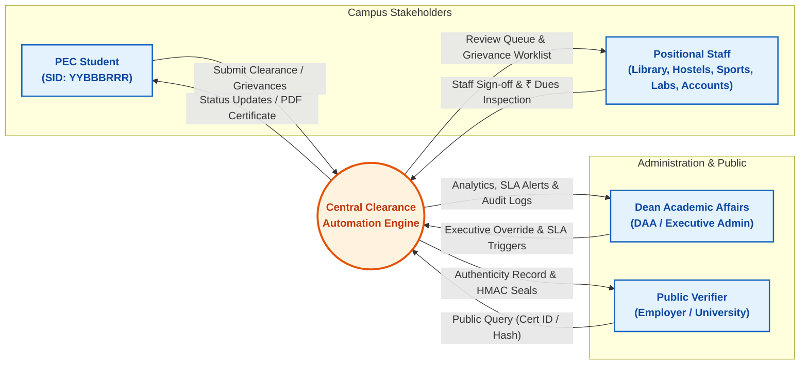
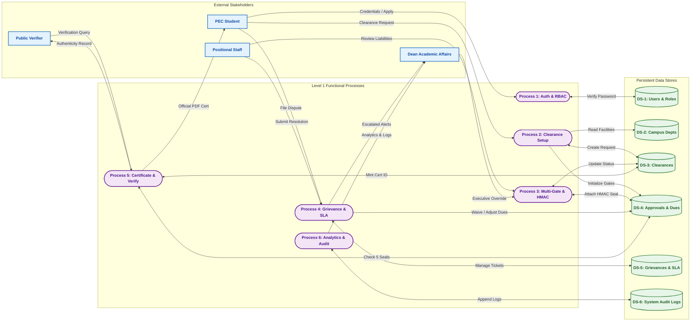

# Data Flow Diagrams (DFD) & Decision Specifications
## Academic Grievance, No-Dues & Clearance Automation Engine

**Institution:** Punjab Engineering College (Deemed to be University), Chandigarh  
**Course:** Software Engineering  
**Supervisor:** Dr. Rajesh Bhatia  
**Authors:** Raghav Bhardwaj & Karan Jain (B.Tech CSE, Batch 2022–2026)  
**Document Scope:** Level 0 (Context), Level 1 (Decomposition), Core Decision Table, Core Decision Tree, and Detailed Process Explanations  

---

## Table of Contents

1. [DFD Level 0: Context Analysis Diagram](#1-dfd-level-0-context-analysis-diagram)
   - [Level 0 Context Diagram](#level-0-context-diagram)
   - [Architectural Explanation & External Entities](#architectural-explanation--external-entities)
   - [Boundary Data Flows Summary](#boundary-data-flows-summary)
2. [DFD Level 1: System Decomposition Diagram](#2-dfd-level-1-system-decomposition-diagram)
   - [Level 1 System Data Flow Diagram](#level-1-system-data-flow-diagram)
   - [Functional Subsystems Explanation (Processes 1 to 6)](#functional-subsystems-explanation-processes-1-to-6)
   - [Persistent Data Stores Explanation (DS-1 to DS-6)](#persistent-data-stores-explanation-ds-1-to-ds-6)
3. [Clearance Pipeline Decision Logic: Table & Tree](#3-clearance-pipeline-decision-logic-table--tree)
   - [Decision Table: Multi-Gate Clearance Pipeline Matrix](#decision-table-multi-gate-clearance-pipeline-matrix)
   - [Decision Table Explanation (Chain of Responsibility & Barriers)](#decision-table-explanation-chain-of-responsibility--barriers)
   - [Decision Tree: Clearance Gating & Barrier Enforcement](#decision-tree-clearance-gating--barrier-enforcement)
   - [Decision Tree Explanation](#decision-tree-explanation)

---

## 1. DFD Level 0: Context Analysis Diagram

The **Level 0 Context Diagram** defines the primary environmental boundary of the PEC Clearance Automation Engine, mapping all interactions between campus stakeholders and the central automated processing engine.

### Level 0 Context Diagram

### Architectural Explanation & External Entities

The Context Diagram encapsulates the entire institutional software system within a single high-level transformation bubble, isolating internal operations from four external entities:

1. **PEC Student (`Student`):**
   - **Identity:** Identified by an immutable 8-digit PEC Student Identifier (`YYBBBRRR`, e.g., `22103042`).
   - **Function:** Applies for clearance at degree completion or milestone exit, monitors real-time progress across all 5 departmental facilities, reviews itemized outstanding liabilities in Indian Rupees (`₹`), files grievance appeals against disputed charges, and retrieves digitally signed vector PDF certificates.
2. **Positional Department Staff (`Staff`):**
   - **Identity:** Positional signatories representing Dr. B.R. Ambedkar Central Library, PEC Hostels, Gymkhana (Sports), Department Computing/Hardware Labs, and the Accounts Branch.
   - **Function:** Authenticates under facility role scopes, inspects physical asset returns, records itemized liabilities (`due_amount` in INR), issues digital approvals sealed with keyed HMAC-SHA256 tokens, and arbitrates student grievance tickets.
3. **Dean Academic Affairs (`Admin` / DAA):**
   - **Identity:** Executive academic oversight persona.
   - **Function:** Monitors campus-wide clearance efficiency and department bottleneck latency, receives high-priority alerts for breached Service Level Agreements (SLAs), and possesses executive authority to override clearance rejections with mandatory audit justification.
4. **Public Certificate Verifier (`Verifier`):**
   - **Identity:** External employers, background screening agencies, and international universities.
   - **Function:** Performs tokenless, zero-login cryptographic verification of issued certificates using either the unique Certificate ID (`PEC-CLR-YYYY-XXXXX`) or the 64-character SHA-256 public hash digest.

### Boundary Data Flows Summary

- **Inbound Data Flows:**
  - `Clearance Application`: Student SID, academic year, semester, and clearance justification.
  - `Grievance Submission`: Department target, subject, dispute narrative, and priority tier (`LOW`, `MEDIUM`, `HIGH`, `CRITICAL`).
  - `Liability Inspection & Sign-off`: Approval decision (`APPROVED` or `REJECTED`), itemized dues in INR (`₹`), and reviewer commentary.
  - `Executive Override Order`: Clearance ID, department code, and mandatory DAA justification.
  - `Public Verification Query`: Certificate ID string or SHA-256 hash digest.
- **Outbound Data Flows:**
  - `Live Pipeline Status`: Multi-gate progress status and itemized dues across all facilities.
  - `Tamper-Proof PDF Certificate`: Printable vector PDF embedded with institutional seals and SHA-256 digest.
  - `Department Review Queue`: Filtered list of pending student clearance records restricted to staff's facility.
  - `SLA Breach Alerts`: Real-time administrative notifications for overdue grievances.
  - `Authenticity Verification Record`: JSON payload confirming validity, student metadata, and 5 departmental HMAC seals.

---

## 2. DFD Level 1: System Decomposition Diagram

The **Level 1 System Data Flow Diagram** decomposes the top-level system into six dedicated, single-responsibility operational subsystems (`Process 1` through `Process 6`), interacting directly with six persistent relational data stores (`DS-1` through `DS-6`).

### Level 1 System Data Flow Diagram

### Functional Subsystems Explanation (Processes 1 to 6)

1. **Process 1: User Authentication & Role Authorization (`auth.py`, `security.py`)**
   - **Function:** Authenticates inbound users against Bcrypt-salted password hashes, validates PEC institutional domains (`@pec.edu.in`), issues signed cryptographic JSON Web Tokens (JWT), and checks role claims (`STUDENT`, `STAFF`, `ADMIN`) to protect API routes.
   - **Inputs:** Raw email and plaintext password from Student, Staff, or Admin; stored hashes from `DS-1`.
   - **Outputs:** Signed Bearer JWT access tokens with encoded identity claims (`sub`, `role`, `exp`).
2. **Process 2: Clearance Application & Gating Setup (`clearance.py`)**
   - **Function:** Enforces the institutional single-active-request invariant, captures student degree milestone details, provisions the master clearance record in `DS-3`, and initializes 5 departmental approval records in `DS-4` (Gate 1 facilities set to `PENDING`; Gates 2 & 3 set to `WAITING_PREREQUISITE`).
   - **Inputs:** Clearance application packet from Student; active facility records from `DS-2`.
   - **Outputs:** Master clearance record in `DS-3`; 5 initialized approval rows in `DS-4`; audit event to `DS-6`.
3. **Process 3: Departmental Review, Chain of Responsibility & HMAC Signing (`chain_of_responsibility.py`)**
   - **Function:** Orchestrates the multi-signatory clearance pipeline using the behavioral Chain of Responsibility design pattern. Enforces parallel reviews at Gate 1, sequential dependency barriers at Gate 2 and Gate 3, calculates keyed HMAC-SHA256 digital seals upon approval, handles DAA executive overrides, and mutates master clearance status.
   - **Inputs:** Staff decisions (`APPROVED` / `REJECTED`), itemized dues in INR (`₹`), DAA override commands; current approval states from `DS-4`.
   - **Outputs:** Cryptographic HMAC signature seals attached to `DS-4`; unlocked downstream gates; master status update in `DS-3`.
4. **Process 4: Grievance Redressal & SLA Escalation Engine (`grievance.py`)**
   - **Function:** Provides an institutional dispute mechanism for students contesting incorrect dues or missing records. Automatically assigns dynamic SLA deadlines based on ticket priority (`CRITICAL`: 4h, `HIGH`: 12h, `MEDIUM`: 24h, `LOW`: 48h). Scans for expired tickets and triggers automated escalation banners directly to the DAA dashboard.
   - **Inputs:** Student grievance filings; staff resolution decisions; periodic SLA scan pulses.
   - **Outputs:** Grievance records in `DS-5`; adjusted/waived dues in `DS-4`; real-time SLA breach alerts to Admin.
5. **Process 5: Certificate Minting, PDF Rendering & Verification (`certificate.py`, `pdf_generator.py`)**
   - **Function:** Validates that all 5 departmental facilities have recorded `APPROVED` statuses with valid cryptographic HMAC seals. Unlocks the release of the student's ₹10,000 Caution Money refund, mints a permanent Certificate ID (`PEC-CLR-YYYY-XXXXX`), calculates a 64-character SHA-256 verification hash, generates an official vector PDF with letterhead, and serves tokenless public verifications.
   - **Inputs:** 5 valid approval records from `DS-4`; clearance record from `DS-3`; public verification queries.
   - **Outputs:** Minted certificate details in `DS-3`; printable binary PDF to Student; verification JSON to Verifier.
6. **Process 6: Institutional Administration, Analytics & Audit (`admin.py`)**
   - **Function:** Computes institutional clearance metrics (overall completion rates, average department review latency, clearance bottlenecks), and maintains an immutable append-only system audit log tracking every security and operational event.
   - **Inputs:** Internal lifecycle event signals; aggregate queries across `DS-3`, `DS-4`, and `DS-5`.
   - **Outputs:** Real-time campus analytics payloads and append-only audit entries in `DS-6`.

### Persistent Data Stores Explanation (DS-1 to DS-6)

- **`DS-1: Users & Personas` (`users` table):** Stores user credentials, salted Bcrypt password hashes, personas (`STUDENT`, `STAFF`, `ADMIN`), student roll numbers (SIDs), and staff department assignments.
- **`DS-2: Campus Departments` (`departments` table):** Institutional configuration of the 5 facilities (Library, Hostels, Sports, Labs, Accounts), gate classifications (Gate 1, 2, or 3), and positional head titles.
- **`DS-3: Clearance Requests` (`clearance_requests` table):** Master clearance records storing student references, academic session, overall status (`PENDING`, `APPROVED`, `REJECTED`), certificate ID, and public SHA-256 hash digest.
- **`DS-4: Department Approvals & HMAC Seals` (`department_approvals` table):** Operational approval rows containing review status (`WAITING_PREREQUISITE`, `PENDING`, `APPROVED`, `REJECTED`), itemized dues in INR (`due_amount`), reviewer remarks, and keyed HMAC-SHA256 signature seals.
- **`DS-5: Grievances & SLA Timers` (`grievances` table):** Dispute tickets holding priority classification, computed absolute SLA expiration timestamps, escalation flags (`is_escalated`), staff responses, and resolution timestamps.
- **`DS-6: System Audit Logs` (`audit_logs` table):** Append-only audit trail capturing actor ID, actor role, immutable action verb, affected entity ID, textual details, and microsecond UTC timestamps.

---

## 3. Clearance Pipeline Decision Logic: Table & Tree

The core algorithmic innovation of the engine is the **Multi-Gate Clearance Pipeline & Barrier Enforcement Logic**, implemented via the behavioral **Chain of Responsibility** pattern. Below are the definitive Decision Table and Decision Tree governing all pipeline transitions.

### Decision Table: Multi-Gate Clearance Pipeline Matrix

This decision table formalizes the state transition and gating barrier rules enforced by the **Chain of Responsibility** engine (`Process 3`):

| Rule ID | Gate 1 Status (Lib / Host / Sport) | Gate 2 Status (Dept Labs) | Gate 3 Status (Accounts) | DAA Override? | Action Target & Enforced State Transition |
| :---: | :---: | :---: | :---: | :---: | :--- |
| **R-101** | All `PENDING` | `WAITING` | `WAITING` | No | Allow concurrent Gate 1 reviews; mutate to `APPROVED` or `REJECTED`; mint HMAC seal on approval. |
| **R-102** | Any `PENDING` / `REJECTED` | `WAITING` | `WAITING` | No | **BLOCK GATE 2 WITH HTTP 400:** Reject review attempt; Gate 1 facilities incomplete or disputed. |
| **R-103** | Any `REJECTED` (Dues > ₹0) | `WAITING` | `WAITING` | No | **REJECT MASTER STATUS:** Set overall request to `REJECTED`; prompt student to settle dues or file grievance. |
| **R-104** | All `APPROVED` | `WAITING` | `WAITING` | No | **AUTO-UNLOCK GATE 2:** Automatically advance Gate 2 (Dept Labs) from `WAITING` to `PENDING`. |
| **R-105** | All `APPROVED` | `PENDING` | `WAITING` | No | Allow HOD Labs review; inspect lab kits; if clear, mint HMAC seal and set status to `APPROVED`. |
| **R-106** | All `APPROVED` | `APPROVED` | `WAITING` | No | **AUTO-UNLOCK GATE 3:** Automatically advance Gate 3 (Accounts) from `WAITING` to `PENDING`. |
| **R-107** | All `APPROVED` | `APPROVED` | `PENDING` | No | Allow Accounts review; reconcile dues; authorize release of ₹10,000 Caution Money deposit refund. |
| **R-108** | All `APPROVED` | `APPROVED` | `APPROVED` | No | **MASTER CLEARANCE GRANTED:** Mutate master status to `APPROVED`; mint Certificate ID & SHA-256 Digest. |
| **R-109** | Any `REJECTED` | Any | Any | **Yes (DAA)** | **EXECUTIVE OVERRIDE:** Mark target department `APPROVED`; clear dues; log `ADMIN_OVERRIDE` in `DS-6`. |

### Decision Table Explanation (Chain of Responsibility & Barriers)

1. **Gate 1 Parallel Independence (Rule R-101):** The three Gate 1 departments (Central Library, Hostels, Sports) operate concurrently. A rejection or delay in one does not block staff members in the other two from inspecting assets or recording sign-offs.
2. **Sequential Dependency Barriers (Rules R-102 & R-106):** Gate 2 (Department Labs) cannot be reviewed until all three Gate 1 facilities are `APPROVED`. Any attempt by lab staff to sign off prematurely is rejected with HTTP `400 Bad Request`. Similarly, Gate 3 (Accounts) cannot be accessed until Gate 2 is fully cleared.
3. **Automated Pipeline Advancement (Rules R-104 & R-106):** The system dynamically scans prerequisites upon every sign-off. When the final Gate 1 facility is approved, Gate 2 automatically transitions from `WAITING_PREREQUISITE` to `PENDING`. When Gate 2 is approved, Gate 3 automatically unlocks.
4. **Caution Money Disbursement & Master Certification (Rules R-107 & R-108):** Accounts Branch review triggers financial reconciliation. Once Gate 3 is approved, the institutional Caution Money escrow deposit (₹10,000.00) is marked for release, and the master request status becomes `APPROVED`.
5. **Executive Override Powers (Rule R-109):** The Dean Academic Affairs retains statutory authority to override departmental rejections (e.g., in cases of administrative error or approved waivers), immediately setting the target department to `APPROVED` and recording a mandatory audit trail entry in `DS-6`.

---

### Decision Tree: Clearance Gating & Barrier Enforcement

```mermaid
flowchart LR
    subgraph Gate1 ["1. Gate 1: Departmental Stage (Parallel)"]
        direction TB
        G1_Start(["Student Clearance Initiated"]) --> G1_Init["Initialize Gate 1: Library, Hostel, Sports as PENDING<br/>Initialize Gate 2 & Gate 3 as WAITING_PREREQUISITE"]
        G1_Init --> G1_Eval{"Gate 1 Reviews Completed?"}
        G1_Eval -- "Any Still Pending" --> G1_Wait["Hold Gate 2 Labs in WAITING_PREREQUISITE"]
        G1_Eval -- "Any Rejected (Dues)" --> G1_Rej{"DAA Override?"}
        G1_Rej -- "No" --> G1_Pay["Student Resolves Due or Grievance"] --> G1_Eval
        G1_Rej -- "Yes" --> G1_Over["DAA Marks Target Dept APPROVED<br/>Logs Mandatory Audit Justification"] --> G1_Pass["Gate 1 Cleared"]
        G1_Eval -- "Library && Hostel && Sports == APPROVED" --> G1_Pass
    end

    subgraph Gate2 ["2. Gate 2: Academic Labs Stage"]
        direction TB
        G1_Pass --> G2_Unlock["Auto-Advance Gate 2 Labs: WAITING -> PENDING"]
        G2_Unlock --> G2_Eval{"Lab Equipment Review?"}
        G2_Eval -- "Rejected: Equipment Missing" --> G2_Rej{"DAA Override?"}
        G2_Rej -- "No" --> G2_Pay["Replace Equipment / Disputed Grievance"] --> G2_Eval
        G2_Rej -- "Yes" --> G2_Over["DAA Marks Labs APPROVED"] --> G2_Pass["Gate 2 Cleared: Labs HMAC Seal Minted"]
        G2_Eval -- "Approved: Equipment Clear" --> G2_Pass
    end

    subgraph Gate3 ["3. Gate 3: Accounts & Institutional Certification"]
        direction TB
        G2_Pass --> G3_Unlock["Auto-Advance Gate 3 Accounts: WAITING -> PENDING"]
        G3_Unlock --> G3_Eval{"Accounts Final Review?"}
        G3_Eval -- "Rejected: Dues Unpaid" --> G3_Hold["Hold ₹10,000 Caution Money Escrow"]
        G3_Eval -- "Approved: Reconciliation Clear" --> G3_Pass["Accounts HMAC Seal Minted"]
        G3_Pass --> G3_Final["Authorize Caution Money Refund Release: ₹10,000.00<br/>Master Clearance Status -> APPROVED<br/>Mint Certificate ID: PEC-CLR-YYYY-XXXXX<br/>Compute SHA-256 Public Verification Digest"]
        G3_Final --> G3_Done(["Official Clearance Certificate Ready"])
    end
```

### Decision Tree Explanation

The Decision Tree visually traces the deterministic multi-gate clearance lifecycle:
- **Phase 1 (Gate 1 Execution):** Initializes the three non-academic facilities concurrently. If any liability is found, the clearance halts with status `REJECTED`, prompting the student to pay or file a grievance. Only when all three facilities record `APPROVED` (or receive DAA override) does the pipeline advance.
- **Phase 2 (Gate 2 Execution):** The automated engine advances Gate 2 from `WAITING` to `PENDING`. Academic computing/hardware labs verify asset returns. Approval seals the department record with an HMAC-SHA256 signature; rejection blocks further progress.
- **Phase 3 (Gate 3 Execution):** Accounts Branch reconciles tuition, hostel, and fee accounts. Once approved, the ₹10,000 Caution Money refund is authorized, the master status becomes `APPROVED`, and the system generates the unique Certificate ID and public verification digest.
