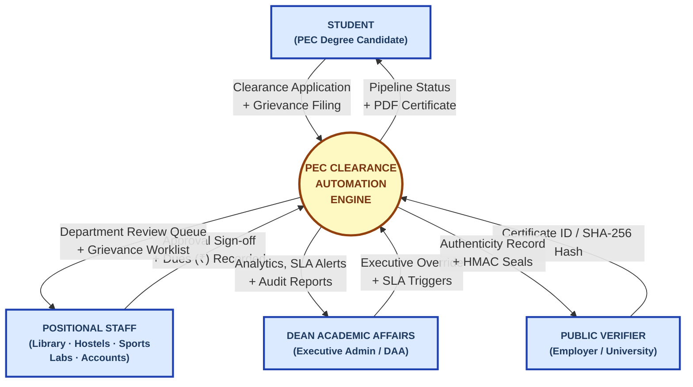
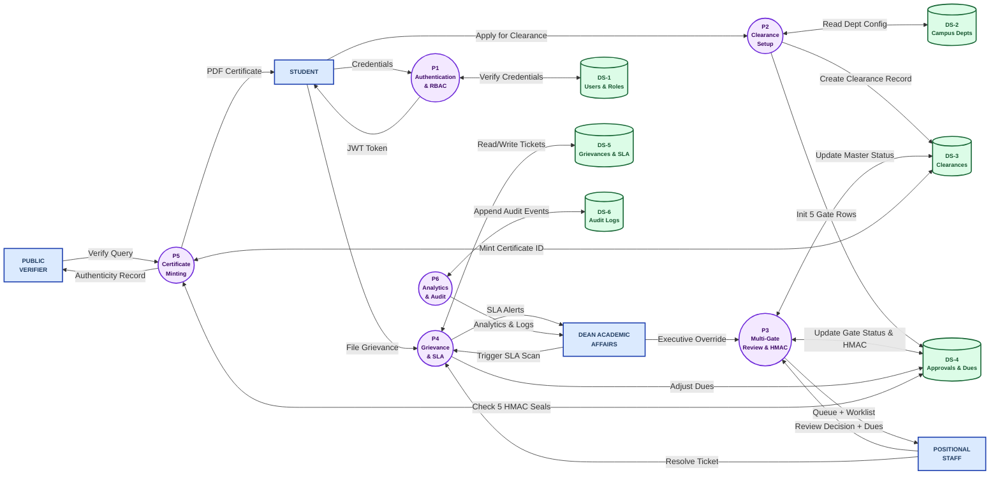
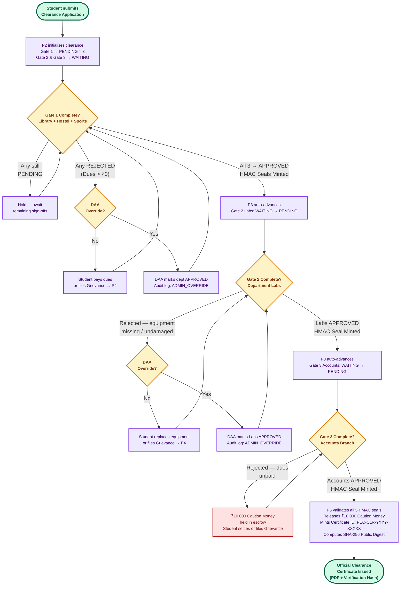

# Data Flow Diagrams (DFD)
## Academic Grievance, No-Dues & Clearance Automation Engine

**Institution:** Punjab Engineering College (Deemed to be University), Chandigarh  
**Course:** Software Engineering  
**Supervisor:** Dr. Rajesh Bhatia  
**Authors:** Raghav Bhardwaj & Karan Jain (B.Tech CSE, Batch 2022–2026)  
**Notation:** Yourdon / De Marco — Circles = Processes, Rectangles = External Entities, Open Boxes = Data Stores  

---

## 1. DFD Level 0 — Context Diagram

The Level 0 Context Diagram treats the entire system as a **single process bubble** and maps every interaction between the system and the four external entities on campus.

### Level 0 Explanation

| External Entity | Role | What It Sends In | What It Receives Out |
|:---|:---|:---|:---|
| **Student** | Final-year student seeking clearance | Login details, clearance application, grievance complaints | Live clearance status, official PDF certificate |
| **Positional Staff** | Officials from Library, Hostels, Sports, Labs, and Accounts | Department approvals/rejections and any pending fine amounts (₹) | List of students waiting for review, grievance tickets to resolve |
| **Dean Academic Affairs** | Head administrator overlooking campus clearances | Special approval override commands, grievance checks | Overall college clearance reports, alerts for delayed grievances |
| **Public Verifier** | Outside company, university, or background checker | Student Certificate ID or QR/Hash code | Instant online confirmation whether certificate is genuine |

---

## 2. DFD Level 1 — System Decomposition

The Level 1 DFD decomposes the single engine bubble into **six functional processes** connected by data flows and six persistent data stores.

### Process Descriptions

| Process | Name | Description |
|:---:|:---|:---|
| **P1** | User Login & Access Control | Checks student and staff passwords securely; issues a secure digital login token with their role (Student, Staff, or Admin). |
| **P2** | Clearance Application Setup | Lets a student submit one active clearance application; creates the application record and sets up the 5 department checklist rows. |
| **P3** | Multi-Gate Department Review | Sends applications through Gate 1 (Library, Hostels, Sports), Gate 2 (Labs), and Gate 3 (Accounts) in order; saves digital signatures when approved. |
| **P4** | Grievance & Helpdesk Engine | Helps students file complaints if fines or rejections are wrong; sets a resolution deadline and alerts the Dean if delayed. |
| **P5** | Certificate Generation & Verification | Confirms all 5 departments approved; approves release of ₹10,000 caution money refund; generates the final downloadable PDF certificate. |
| **P6** | Reports & Activity Audit Log | Keeps a tamper-proof record of every action (approvals, logins, overrides) and calculates campus clearance statistics for the Dean. |

### Data Store Descriptions

| Store | Table | Description |
|:---:|:---|:---|
| **DS-1** | `users` | User accounts, encrypted passwords, roles (Student, Staff, Admin), and student roll numbers. |
| **DS-2** | `departments` | List of college departments (Library, Hostel, Sports, Labs, Accounts) and their gate order. |
| **DS-3** | `clearance_requests` | Master clearance records with overall status (Pending, Approved, Rejected) and certificate details. |
| **DS-4** | `department_approvals` | Approval status for each department, unpaid dues/fines in ₹, and digital approval seals. |
| **DS-5** | `grievances` | Student complaint tickets, priority levels, resolution deadlines, and staff responses. |
| **DS-6** | `audit_logs` | Security history log recording who did what action, to which record, and at what exact time. |

---

## 3. Core Decision Tree — Multi-Gate Clearance Pipeline

The Decision Tree traces the **deterministic gate-by-gate path** from a student's initial application to the final Clearance Certificate, capturing every branch condition enforced by the Chain of Responsibility engine.

### Decision Tree Explanation

The three-gate pipeline enforces **strict sequential dependency barriers**:

- **Gate 1 — Parallel Departmental Stage:** Library, Hostels, and Sports departments operate concurrently. Any rejection blocks further pipeline advancement and routes the student to either pay dues or file a formal grievance (handled by Process 4). The Dean Academic Affairs (DAA) holds an executive override authority at every gate for cases of administrative error or approved waivers, with a mandatory audit trail entry recorded in DS-6.

- **Gate 2 — Academic Labs Stage:** Automatically unlocked only when all three Gate 1 facilities are `APPROVED`. The HOD of Department Labs verifies equipment returns; approval seals the record with an HMAC-SHA256 signature. Any rejection loops back unless overridden by the DAA.

- **Gate 3 — Accounts & Certification Stage:** Automatically unlocked only after Gate 2 is `APPROVED`. The Accounts Branch reconciles all outstanding institutional dues. Upon approval, the ₹10,000 Caution Money deposit is released, Process 5 validates all five HMAC seals, and the system generates the unique Certificate ID and public SHA-256 verification digest — producing the official, tamper-evident PDF clearance certificate.
