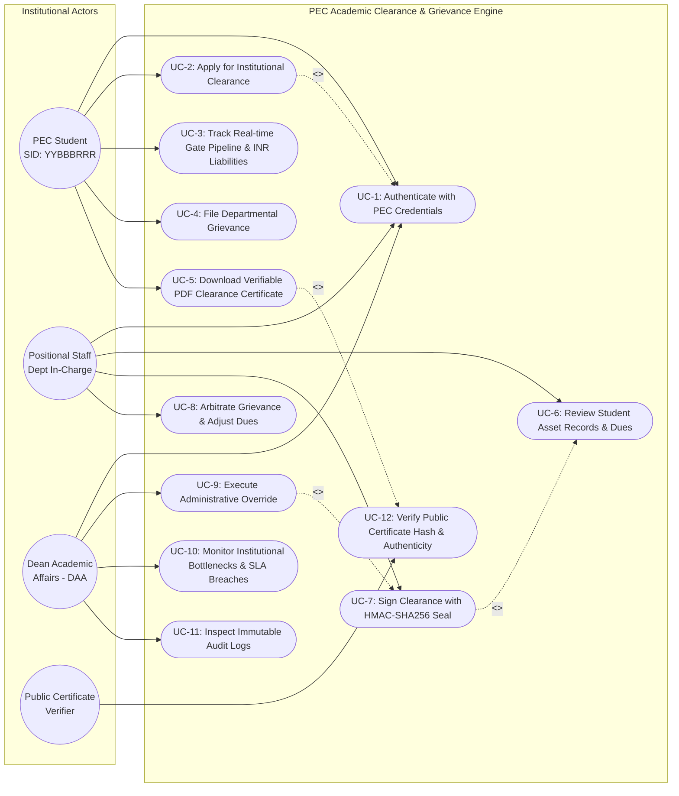
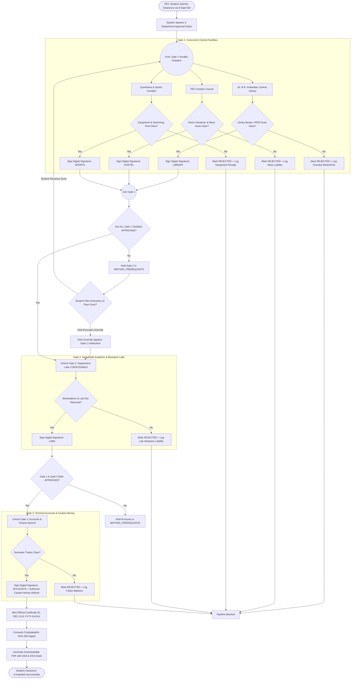
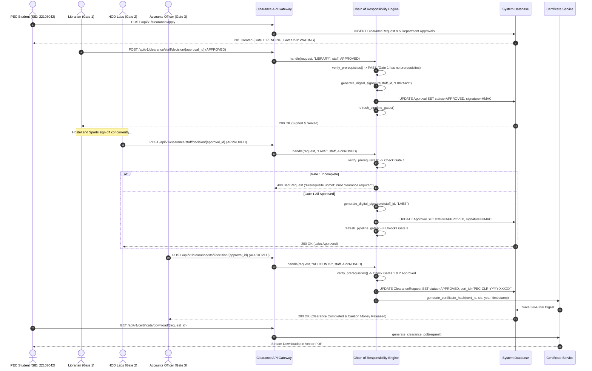
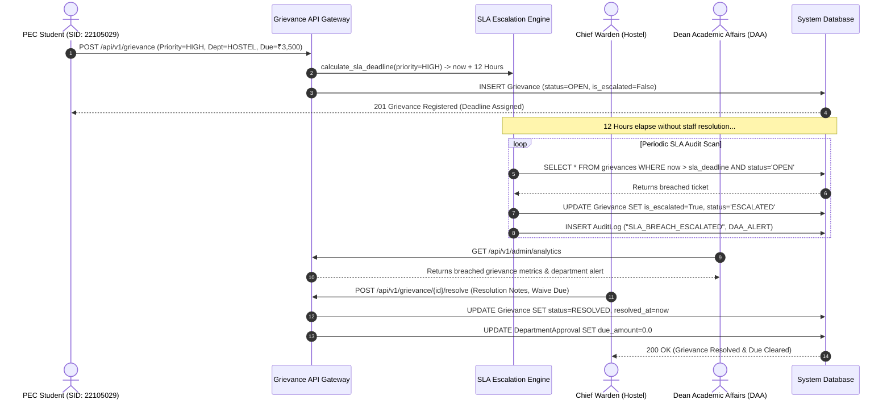
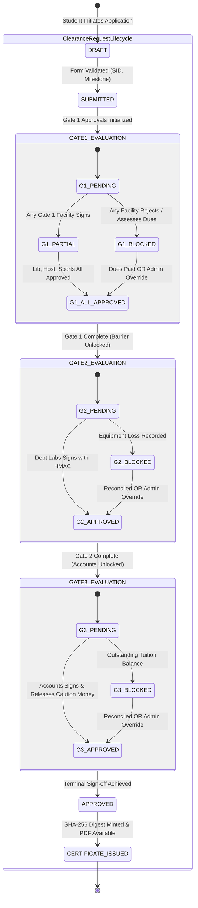

# Unified Modeling Language (UML) Structural & Behavioral Models
## Academic Grievance, No-Dues & Clearance Automation Engine
**Punjab Engineering College (Deemed to be University), Sector 12, Chandigarh**  
**Submitted by:** Raghav Bhardwaj & Karan Jain  
**Submitted to:** Dr. Rajesh Bhatia (Course: Software Engineering)  

---

### OMG UML 2.5 Modeling Rules & Standards Compliance Matrix
This document conforms strictly to the **Object Management Group (OMG) UML 2.5 Superstructure Specification**:

| Diagram Type | Diagram Classification | Formal OMG UML 2.5 Rules & Semantics Applied | Section |
| :--- | :---: | :--- | :--- |
| **Use Case Diagram** | Behavioral | Actors outside system boundary; use cases within boundary; precise `<<include>>` (mandatory functional dependency) and `<<extend>>` (conditional extension) stereotypes. | Section 1 |
| **Class Diagram** | Structural | 3-compartment notation; member visibility indicators (`+` Public, `#` Protected, `-` Private); precise relationship semantics: Generalization (`<|--`), Realization (`..|>`), Composition (`*--`), Aggregation (`o--`), Association (`-->`), Dependency (`..>`); multiplicities on both ends. | Section 2 |
| **Activity Diagram** | Behavioral | Concurrency fork and join bars; decision and merge diamonds; action states; initial/final activity nodes; swimlane encapsulation of gate authorities. | Section 3 |
| **Sequence Diagram** | Interaction | Participant lifelines; strictly descending chronological time axis; synchronous calls (`->>`), returns (`-->>`); interaction use fragments (`alt`, `opt`, `loop`). | Section 4 |
| **State Machine Diagram** | Behavioral | State transitions triggered by events and guards (`Event [guard] / action`); composite states (`Gate 1`, `Gate 2`, `Gate 3`); initial pseudo-states (`[*]`). | Section 5 |
| **Component & Deployment**| Structural / Physical | 3-tier boundary separation (Client UI $\rightarrow$ Application Services $\rightarrow$ Persistent Data Store); interface connectors and protocol definitions. | Section 6 |

---

## 1. Use Case Model & Diagram

### 1.1 Actors & Role Boundaries
- **Student Actor:** Registered PEC student identified by an 8-digit SID (e.g., `22103042`).
- **Positional Staff Actor:** Departmental authority operating under permanent institutional designations (*Librarian*, *Chief Warden*, *Gymkhana President*, *HOD Labs*, *Accounts Officer*).
- **Dean Academic Affairs (DAA / Admin Actor):** Executive authority holding override privileges and institutional audit oversight.
- **Public Certificate Verifier Actor:** External unauthenticated party validating clearance credentials.

### 1.2 Use Case Diagram


---

## 2. Static Structural Model: Class Diagram

The class diagram captures the object-oriented domain entities, the Chain of Responsibility behavioral pattern handlers, cryptographic helper utilities, and service orchestration layers:

```mermaid
classDiagram
    %% Core Domain Models
    class User {
        +int id
        +string email
        +string hashed_password
        +string full_name
        +string role
        +string sid
        +string department_code
        +bool is_active
        +datetime created_at
        +verify_password(plain: string) bool
    }

    class Department {
        +int id
        +string code
        +string name
        +string head_title
        +int gate_number
        +datetime created_at
    }

    class ClearanceRequest {
        +int id
        +int student_id
        +string academic_year
        +int semester
        +string reason
        +string status
        +string certificate_id
        +string certificate_hash
        +datetime completion_date
        +datetime created_at
        +datetime updated_at
    }

    class DepartmentApproval {
        +int id
        +int request_id
        +int department_id
        +string status
        +float due_amount
        +string remarks
        +string digital_signature
        +datetime signed_at
        +int signed_by_user_id
        +datetime created_at
        +datetime updated_at
    }

    class Grievance {
        +int id
        +int student_id
        +int department_id
        +int clearance_request_id
        +string subject
        +string description
        +string priority
        +float disputed_amount
        +string status
        +datetime sla_deadline
        +bool is_escalated
        +datetime resolved_at
        +string resolution_notes
        +datetime created_at
    }

    class AuditLog {
        +int id
        +int user_id
        +string action
        +string entity_type
        +int entity_id
        +string details
        +datetime timestamp
    }

    %% Chain of Responsibility Classes
    class DepartmentHandler {
        <<abstract>>
        #DepartmentHandler _next_handler
        +set_next(handler: DepartmentHandler) DepartmentHandler
        +handle(request: ClearanceRequest, dept_code: string, user: User, action: string, remarks: string, dues: float) dict*
        #verify_prerequisites(request: ClearanceRequest, db: Session) bool*
        #generate_signature(staff_id: int, dept_code: string, req_id: int) string
    }

    class LibraryHandler {
        +gate_number: 1
        #verify_prerequisites(request, db) bool
    }

    class HostelHandler {
        +gate_number: 1
        #verify_prerequisites(request, db) bool
    }

    class SportsComplexHandler {
        +gate_number: 1
        #verify_prerequisites(request, db) bool
    }

    class DepartmentLabsHandler {
        +gate_number: 2
        #verify_prerequisites(request, db) bool
    }

    class AccountsHandler {
        +gate_number: 3
        #verify_prerequisites(request, db) bool
    }

    class ClearanceChainBuilder {
        +build_chain() DepartmentHandler
        +refresh_pipeline_gates(request: ClearanceRequest, db: Session) void
    }

    %% Service Providers
    class CertificateService {
        +generate_certificate_hash(cert_id: string, sid: string, year: string, date: datetime) string
        +generate_clearance_pdf(request: ClearanceRequest, db: Session) bytes
    }

    class GrievanceService {
        +calculate_sla_deadline(priority: string) datetime
        +check_and_escalate_sla(db: Session) list
        +resolve_grievance(id: int, notes: string, db: Session) Grievance
    }

    %% Inheritance Relationships
    DepartmentHandler <|-- LibraryHandler
    DepartmentHandler <|-- HostelHandler
    DepartmentHandler <|-- SportsComplexHandler
    DepartmentHandler <|-- DepartmentLabsHandler
    DepartmentHandler <|-- AccountsHandler

    %% Associations & Multiplicities
    User "1" --> "0..*" ClearanceRequest : submits
    User "1" --> "0..*" DepartmentApproval : signs
    User "1" --> "0..*" Grievance : files
    User "1" --> "0..*" AuditLog : triggers

    ClearanceRequest "1" *-- "5" DepartmentApproval : contains
    ClearanceRequest "1" o-- "0..*" Grievance : associates
    Department "1" --> "0..*" DepartmentApproval : governs
    Department "1" --> "0..*" Grievance : receives

    ClearanceChainBuilder ..> DepartmentHandler : constructs
    ClearanceChainBuilder ..> ClearanceRequest : evaluates
    CertificateService ..> ClearanceRequest : mints
    GrievanceService ..> Grievance : arbitrates
```



---

## 3. Dynamic Behavioral Model: Activity Diagram

This activity diagram captures the end-to-end lifecycle of a PEC clearance request, illustrating parallel concurrency forks, barrier joins, and sequential dependency gates:



---

## 4. Interaction Models: Sequence Diagrams

### 4.1 Sequence Diagram 1: Multi-Gate Approval & Cryptographic Minting


### 4.2 Sequence Diagram 2: Grievance Lifecycle & Automated DAA Escalation


### 4.3 Sequence Diagram 3: Administrative Override & Concurrency Race Prevention
```mermaid
sequenceDiagram
    autonumber
    actor DAA as Dean Academic Affairs (Admin)
    actor Staff as Positional Staff
    participant API as Administration API
    participant CoR as Chain of Responsibility Engine
    participant DB as System Database (Serialized Transaction)

    Staff->>API: POST /api/v1/clearance/staff/decision (Mark REJECTED, ₹500 Due)
    API->>DB: UPDATE DepartmentApproval SET status='REJECTED', due_amount=500.0
    DB-->>Staff: 200 OK (Gate Blocked)

    Note over DAA, DB: Student petitions DAA; DAA authorizes immediate override

    DAA->>API: POST /api/v1/admin/override/{approval_id} (Reason="Approved by DAA Council")
    API->>DB: BEGIN TRANSACTION (SERIALIZABLE)
    API->>DB: UPDATE DepartmentApproval SET status='APPROVED', due_amount=0.0
    API->>CoR: generate_digital_signature(admin_id, dept_code)
    API->>DB: UPDATE DepartmentApproval SET digital_signature=HMAC
    API->>CoR: refresh_pipeline_gates(request, db)
    CoR->>DB: Unblock downstream dependent gates
    API->>DB: INSERT AuditLog ("ADMIN_OVERRIDE", admin_id, metadata)
    API->>DB: COMMIT TRANSACTION
    DB-->>DAA: 200 OK (Department Overridden & Downstream Gates Unlocked)
```

---

## 5. Behavioral State Machine Diagram

This state machine models the discrete status lifecycles of both the master clearance request and individual department approval gates:



---

## 6. System Architecture & Component Deployment Diagram

The component diagram defines the physical and logical boundaries of the system, verifying complete separation between presentation, application services, and persistent storage:

```mermaid
flowchart TB
    subgraph ClientTier ["Presentation Tier (React 19 SPA)"]
        UI_Nav["Navbar & Persona Switcher"]
        UI_Pipe["ClearancePipeline (3 Gates)"]
        UI_Griev["GrievanceModal (SLA Calculator)"]
        UI_Cert["CertificateModal (Vector PDF Preview)"]
        UI_Admin["AdminDashboard (Analytics & Overrides)"]
        UI_Verify["VerifyCertificate (Public Portal)"]
    end

    subgraph APITier ["Application Service Tier (FastAPI Gateway)"]
        Router_Auth["/api/v1/auth (JWT Bcrypt)"]
        Router_Clear["/api/v1/clearance (Workflow)"]
        Router_Griev["/api/v1/grievance (SLA Engine)"]
        Router_Admin["/api/v1/admin (DAA Analytics)"]
        Router_Cert["/api/v1/certificate (PDF & Public Hash)"]
    end

    subgraph EngineTier ["Domain Logic & Behavioral Patterns"]
        CoR_Engine["Chain of Responsibility Engine\n(Gate 1 -> Gate 2 -> Gate 3)"]
        Crypto_Engine["Cryptographic Engine\n(HMAC-SHA256 & SHA-256 Digits)"]
        SLA_Engine["SLA Breach & Auto-Escalation Timer"]
        PDF_Engine["ReportLab Vector PDF Renderer\n(PEC Crest, DAA & DSA Signatures)"]
    end

    subgraph DataTier ["Persistence Tier (Relational Store)"]
        DB_Users[("users")]
        DB_Depts[("departments")]
        DB_Clear[("clearance_requests")]
        DB_Appr[("department_approvals")]
        DB_Griev[("grievances")]
        DB_Audit[("audit_logs")]
    end

    %% Tier Connectors
    ClientTier -- "REST API (HTTP/JSON with JWT Bearer)" --> APITier
    APITier --> EngineTier
    EngineTier --> DataTier
```


